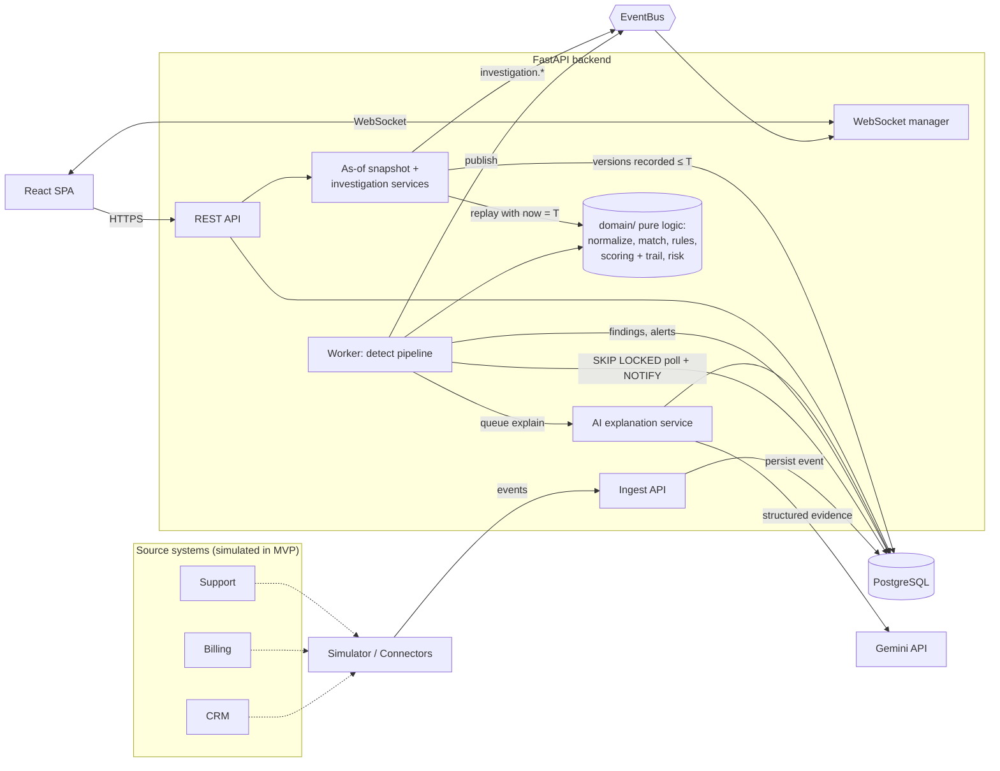
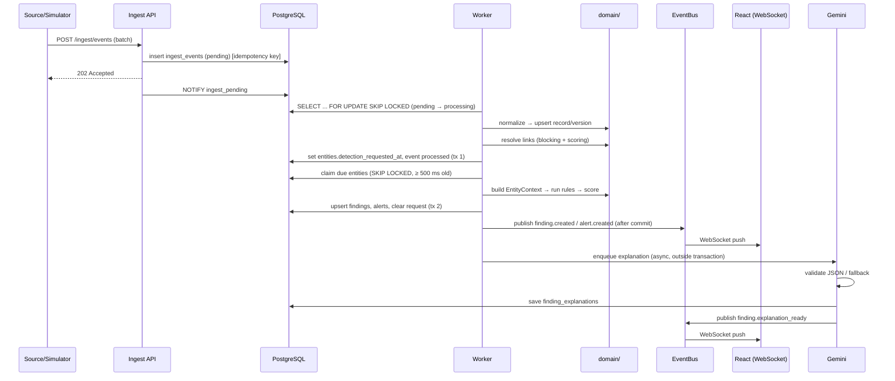

# 02 — Architecture Document

## 1. Architecture at a glance

RealitySync is a **modular monolith** (one FastAPI backend, one React SPA, one PostgreSQL database). It is split into clean layers so agents can work in parallel and so a future move to separate services is possible.



## 2. Technology choices and justification

| Layer | Choice | Why |
|-------|--------|-----|
| Language (backend) | **Python 3.12** | Best ecosystem for fuzzy matching, data work, and Gemini SDK; user's strongest language |
| Web framework | **FastAPI** | Async, Pydantic validation, automatic OpenAPI, native WebSocket support |
| ORM / migrations | **SQLAlchemy 2.0 (async) + Alembic** | Mature, typed, explicit migrations (needed for multi-agent safety) |
| Validation | **Pydantic v2** | Fast, typed schemas shared with OpenAPI |
| Database | **PostgreSQL 16** | JSONB for evidence/payloads, `SKIP LOCKED` queue, `LISTEN/NOTIFY`, partial indexes, strong constraints |
| Queue / events | **Postgres table queue + in-process EventBus** (Redis impl. later) | Fewer moving parts; durable; swap-able behind an interface |
| Matching libs | **rapidfuzz, phonenumbers, email-validator, jellyfish (metaphone)** | Fast, well-maintained, no ML infra needed |
| LLM | **Google Gemini via `google-genai` SDK** | Chosen by user; supports JSON-schema structured output; free tier suitable for portfolio |
| Auth | **JWT access + rotating refresh cookie, Argon2id** | Standard, stateless API calls, safe password storage |
| Frontend | **React 18 + TypeScript + Vite** | Fast dev, strong typing, large ecosystem |
| Styling | **Tailwind CSS + CSS variables (design tokens)** | Tokens map directly to 06_UI_STYLE_GUIDE |
| UI primitives | **Radix UI primitives** (headless) + own components | Accessible by default, fully stylable to the glass/pill look |
| Server state | **TanStack Query** | Caching, refetch on reconnect |
| Client/live state | **Zustand** | Tiny store for live feed, UI state |
| Routing | **React Router 6** | Standard |
| Charts | **Recharts** | Simple React charts, themeable |
| Icons | **lucide-react** | Consistent line icons matching reference |
| Testing | **pytest + pytest-asyncio + httpx; Vitest + Testing Library; Playwright (e2e)** | Full pyramid |
| Quality | **ruff, mypy, ESLint, Prettier, pre-commit** | Consistent output from many agents |
| Packaging | **Docker + Docker Compose** | One-command start |
| CI | **GitHub Actions** | Lint, type, test, audit |

### 2.1 Approved dependency list (the only packages agents may add without a Decision entry)

| Area | Backend (Python) | Frontend (npm) |
|------|------------------|----------------|
| Runtime | `fastapi`, `uvicorn[standard]`, `pydantic`, `pydantic-settings`, `sqlalchemy[asyncio]`, `asyncpg`, `alembic`, `structlog`, `python-ulid` | `react`, `react-dom`, `react-router-dom`, `@tanstack/react-query`, `zustand`, `recharts`, `lucide-react`, `@radix-ui/react-*` (only primitives listed in 06 §6), `clsx`, `tailwind-merge`, `@fontsource-variable/inter` |
| Auth | `argon2-cffi`, `PyJWT` | — |
| Matching / data | `rapidfuzz`, `phonenumbers`, `email-validator`, `jellyfish`, `Faker` | — |
| LLM | `google-genai` | — |
| Dev / test | `pytest`, `pytest-asyncio`, `pytest-cov`, `httpx`, `testcontainers[postgres]`, `schemathesis`, `ruff`, `mypy`, `import-linter`, `pip-audit`, `pre-commit`, `detect-secrets` | `vite`, `@vitejs/plugin-react`, `typescript`, `tailwindcss`, `postcss`, `autoprefixer`, `eslint` (+ `typescript-eslint`, `eslint-plugin-react-hooks`, `eslint-plugin-jsx-a11y`), `prettier`, `vitest`, `@testing-library/react`, `@testing-library/user-event`, `@testing-library/jest-dom`, `jsdom`, `openapi-typescript`, `@playwright/test` |

Pin exact versions in lock files. Anything not on this list needs a Decision row in `08 §6` first.

## 3. System components

### 3.1 Frontend (React SPA)
- **Pages and routes** (T-004 creates them as placeholders; feature tasks fill them):

| Route | Page | Min role |
|-------|------|----------|
| `/login` | Login | public |
| `/` | Dashboard | viewer |
| `/entities` · `/entities/:id` (`?at=<ISO8601>` shows the Time Machine as-of view) | Entities list · Entity detail | viewer |
| `/investigations` · `/investigations/:id` | Investigations list · Investigation result (starting one needs analyst) | viewer |
| `/findings` (`?finding=<id>` opens the drawer; filters live in the query string) | Findings | viewer |
| `/review` | Link review | analyst |
| `/alerts` | Alerts | viewer |
| `/rules` | Rules | admin |
| `/systems` | Systems (incl. failed ingest events) | admin |
| `/simulation` · `/simulation/:runId/evaluation` | Simulation · Evaluation | admin |
| `/settings` (tabs: Profile, Users, API keys, Audit log — last three admin only) | Settings | viewer |
| `/styleguide` | Component gallery (only when `APP_ENV=development`) | — |
- **Data flow:** REST via generated typed client (`openapi-typescript` + thin fetch wrapper) → TanStack Query cache. WebSocket events update the Query cache and the Zustand live feed.
- **Auth:** access token kept **in memory** (never localStorage); refresh via httpOnly cookie; silent refresh on 401.
- **Realtime client (`lib/ws`):** gets a ticket → opens `/ws?ticket=` → subscribes to topics → auto-reconnect with backoff → on reconnect triggers refetch of key queries.

### 3.2 Backend layers (strict dependency direction ↓)

```
api/v1 (routers)        ← HTTP/WS, auth deps, request/response schemas only
   ↓
services/               ← use-cases, transactions, orchestration, audit
   ↓
domain/                 ← PURE logic: normalize, matching, rules, scoring + trail, risk (no I/O, no DB, no HTTP)
   ↓
models/ + db/           ← SQLAlchemy models, session; repositories live in services/ or db/repos
```

Side modules: `realtime/` (EventBus, WS manager), `workers/` (queue consumer), `ai/` (Gemini wrapper, prompts), `simulation/` (generator, injector, runner), `core/` (config, security, logging, errors).

**Rules of the layers**
1. Routers contain no business logic.
2. `domain/` never imports from `models/`, `db/`, `api/`, `services/`, or any I/O library. It works on plain dataclasses/Pydantic models.
3. Services own transactions (one transaction per use-case).
4. Anything slow or unreliable (LLM) happens outside the detection transaction.

### 3.3 Worker (detection pipeline)
Runs inside the API process as an asyncio task by default (`WORKER_MODE=inline`), or as a separate process (`WORKER_MODE=separate`, `python -m app.workers.run`). `separate` mode requires `EVENT_BUS=pg_notify` (config validation fails at startup otherwise), because an in-memory bus cannot reach WebSocket clients held by another process.

The worker runs **two loops**, each with its own durable queue in Postgres:

| Loop | Queue | Claims with | Does |
|------|-------|-------------|------|
| Ingest loop | `ingest_events` where `status='pending'` | `FOR UPDATE SKIP LOCKED` | normalize → upsert record + version → resolve links → set `entities.detection_requested_at` for every affected entity → mark event `processed` — **all in one transaction** |
| Detection loop | `entities` where `detection_requested_at <= now() - 500 ms` | `FOR UPDATE SKIP LOCKED` | build context → run rules → score (+ trail) → upsert findings + alerts → recompute entity risk (03 §M12) → clear `detection_requested_at` (only if unchanged since claim) — **one transaction**; publish events after commit |

Why two loops: a burst of events for one customer only sets the same timestamp again, so detection runs once (coalescing) — and because the request is a database row, a crash cannot lose it. Rule changes and re-evaluation use the same mechanism (set `detection_requested_at` for the affected entities in batches).



**Queue mechanics:** `ingest_events.status` ∈ `pending | processing | processed | failed`. Worker claims a batch with `FOR UPDATE SKIP LOCKED`, processes, and marks done. Stuck `processing` rows older than 5 min are re-queued. Detection for the same entity is **coalesced** through `entities.detection_requested_at` (500 ms minimum age) so bursts of events cause one rule run.

**Concurrency rules (several workers may run at once):**
1. **Per-record order:** before upserting a record the worker takes `pg_advisory_xact_lock(hashtext(source_system_id || record_type || external_id))`. Equal `source_updated_at` → later `received_at` wins, then higher `id`.
2. **Entity creation race:** before resolving an account the worker takes advisory locks on each of its blocking keys (`email_canonical`, `phone_e164`, `name_block`), **sorted**, to avoid deadlocks. Two records for the same new customer then cannot both create a new entity.
3. **Detection:** an entity is claimed by one worker at a time (`SKIP LOCKED` on the `entities` row).

### 3.4 Realtime (EventBus + WebSocket)
- `EventBus` is an interface: `publish(topic, event)`, `subscribe(topic) → AsyncIterator`.
- Implementations (chosen by `EVENT_BUS`):
  - `memory` → `InMemoryEventBus` (default; one process).
  - `pg_notify` → `PgNotifyEventBus`: publish = `NOTIFY rs_events, '<envelope json>'`; each API process `LISTEN`s and fans out locally. Envelopes over 7 KB are sent as `{id, type, topic, ref}` and the receiving process re-reads the row before forwarding. Required for `WORKER_MODE=separate`.
  - Future: `RedisEventBus` (same interface) for many API instances.
- `WSManager` keeps connections, topic subscriptions, and per-connection role. Slow clients are dropped (bounded send queue, 100 messages).
- **Topic permissions:** `findings`, `alerts`, `entities`, `ingest`, `system`, `investigations` → viewer+; `simulation` → admin.
- Envelope, topics, and event types: see 04_API_SPEC §WebSocket.

### 3.5 AI explanation service
- Input: finding + evidence JSON (redacted).
- Calls Gemini with a **system instruction** that treats evidence as data, a **response schema** (JSON), `temperature ≤ 0.3`, `max_output_tokens` limit, 15 s timeout.
- Output validated with Pydantic; on failure one retry, then fallback template renderer (deterministic text from rule metadata). Validation includes `cited_fact_ids` ⊆ the finding's trail fact ids (non-empty); the model can cite facts but never add them.
- Stored with `model`, `prompt_version`, `input_hash`, `is_fallback`, `raw_response`.
- Guardrails: concurrency semaphore, exponential backoff with jitter, daily call budget (`GEMINI_DAILY_BUDGET`), circuit breaker (5 failures → 60 s open).
- **Job queue:** an in-process priority queue (highest `priority_score` first, max 1,000 jobs). It is only a fast path. A **sweeper** (every 30 s) re-queues any active finding whose `explained_evidence_hash` differs from its `evidence_hash`, so dropped jobs and restarts lose nothing. Fallback explanations from a Gemini failure are retried by the sweeper at most once every 10 min, within the budget and only while the circuit is closed. With no `GEMINI_API_KEY`, the fallback is final.
- **Cache:** `input_hash = sha256(prompt_version | model | redacted evidence JSON)`. A cache hit reuses the latest **non-fallback** explanation with that hash. Regenerate skips the cache lookup and always inserts a new row.

### 3.6 Connectors (integration boundary)
```python
class SourceConnector(Protocol):
    system_key: str
    async def fetch_changes(self, since: datetime | None) -> list[IngestEvent]: ...
```
MVP ships `SimulatorConnector`. Future connectors (Stripe, Salesforce, Zendesk) implement the same protocol and push through the same ingest path, so detection code never changes.

### 3.7 Time Machine and investigations
The Time Machine is **replay, not a second engine**: rules and risk signals are pure functions of an `EntityContext` that carries `now`, and every record version keeps its recorded time. So "what could RealitySync have concluded at T?" = build the context from versions recorded ≤ T, set `now = T`, run the same domain code.

| Component | Responsibility |
|-----------|----------------|
| `services/snapshot_service.py` + `domain/timemachine/asof.py` | The service loads an entity's history once (versions recorded ≤ a bound, link decisions, feed watermarks; read-only). The pure `context_at(history, T)` (03 §M13) picks the winning version per record by recorded time, recomputes account membership with the pure matcher (no identity lookahead) and sets `now = T`. The live context builder (T-019) produces the same `EntityContext` type from current state; invariant 14 keeps the two in parity. |
| `services/risk_service.py` | Computes risk (03 §M12) from a context and the context 90 days earlier; writes `entity_risk` / `risk_events` **only** in live mode (detection loop transaction). |
| `services/investigation_service.py` | Builds checkpoints, replays each one through the snapshot service + rules + risk, persists `investigations` and `investigation_checkpoints`, publishes `investigation.progress` / `investigation.completed`. |

- **Execution:** investigations run as background asyncio tasks in the API process (at most 2 concurrently; more wait in an in-process FIFO). They are read-only over source data and deterministic, so on restart any `running` investigation is marked `failed` and can simply be requested again.
- **Isolation:** as-of evaluation never writes findings, alerts or entity state (FR-TMX-005); each checkpoint runs in a read-only transaction.
- **Time axis:** only `record_versions.source_updated_at` (recorded time). `ingest_events.received_at` is never used for replay, because the simulator compresses months of business time into minutes (ADR-12).
- **Configuration:** replay uses today's rule configuration and records a `rule_set` (keys, versions, config hash) in every result (Q-009). Risk weights and level thresholds are code constants in `domain/risk/` for the MVP (not admin-editable), so no new env vars are needed.

## 4. Database
PostgreSQL 16, single database `realitysync`. Full schema in `05_DATABASE_SCHEMA.md`.
- UUID primary keys (`gen_random_uuid()`), `timestamptz` everywhere.
- Enumerations as `text` + `CHECK` constraints (simpler migrations).
- JSONB for raw payloads, normalized fields, evidence, config.
- Indexes designed for the main queries (findings by status/severity, links by entity, events by status).

## 5. Authentication and authorization
| Aspect | Design |
|--------|--------|
| Password storage | Argon2id (`argon2-cffi`) |
| Access token | JWT HS256 (secret from env), 15 min, claims: `sub`, `role`, `exp`, `jti` |
| Refresh token | Opaque random 256-bit, stored hashed in `refresh_tokens`, rotating, 7 days, `httpOnly` `SameSite=Lax` cookie scoped to `/api/v1/auth` |
| RBAC | FastAPI dependency `require_role("admin" \| "analyst" \| "viewer")` on every router |
| Ingest auth | `X-API-Key` (hashed in `api_keys`) or admin JWT |
| WebSocket auth | `POST /auth/ws-ticket` → single-use ticket (60 s TTL, in-memory in the API process that issued it) → `/ws?ticket=…` (WebSocket at the server root, not under `/api/v1`) |
| Brute-force | Rate limit on `/auth/login` (in-memory sliding window; Redis later) |
| CSRF | Refresh endpoint requires the cookie + `X-Requested-With` header; other endpoints use bearer tokens (no cookie auth) |
| Cross-origin dev | The SPA (`:5173`) calls the API (`:8000`) with `credentials: "include"` on `/auth/*`; CORS allows credentials only for `CORS_ORIGINS`. `localhost` ports count as the same site, so `SameSite=Lax` cookies work. |
| Paths | REST under `/api/v1`; `/health`, `/health/ready`, `/ws`, `/openapi.json`, `/docs` at the server root |

## 6. Integrations
| Integration | Purpose | Notes |
|-------------|---------|-------|
| Gemini API | Explanations | Key in `GEMINI_API_KEY`; model in `GEMINI_MODEL`; server-side only |
| Simulator | Source of CRM/Billing/Support events | In-process; also callable through ingest API with an API key |
| (Future) Stripe / Salesforce / Zendesk | Real sources | Via `SourceConnector` |
| (Future) Slack / Email | Alert channels | Subscribe to EventBus `alert.created` |

## 7. Repository layout (monorepo)

```
realitysync/
├─ AGENTS.md                      # entry point for every coding agent (points to docs)
├─ README.md
├─ Makefile                       # make dev | test | lint | check | migrate | seed
├─ docker-compose.yml             # postgres, backend, frontend
├─ .env.example
├─ .github/workflows/ci.yml
├─ docs/                          # 00..09 docs + assets/
├─ backend/
│  ├─ pyproject.toml
│  ├─ alembic.ini
│  ├─ alembic/versions/
│  ├─ app/
│  │  ├─ main.py                  # app factory, lifespan, router mounting
│  │  ├─ core/                    # config.py, logging.py, security.py, errors.py, deps.py, rate_limit.py, clock.py (injectable clock)
│  │  ├─ db/                      # base.py, session.py
│  │  ├─ models/                  # SQLAlchemy models (one file per aggregate)
│  │  ├─ schemas/                 # Pydantic request/response models
│  │  ├─ api/v1/                  # router.py, auth.py, users.py, api_keys.py, ingest.py, entities.py, records.py, links.py, findings.py, alerts.py, rules.py, source_systems.py, dashboard.py, simulation.py, audit.py, investigations.py
│  │  ├─ api/                     # health.py, ws.py (mounted at the server root)
│  │  ├─ services/                # auth_service.py, user_service.py, audit_service.py, ingest_service.py, record_service.py, resolution_service.py, link_service.py, context_builder.py, rule_runner.py, detection_service.py, finding_service.py, alert_service.py, explanation_service.py, dashboard_service.py, simulation_service.py, evaluation_service.py, retention_service.py, snapshot_service.py (as-of contexts), risk_service.py, investigation_service.py
│  │  ├─ domain/
│  │  │  ├─ normalize/            # names.py, nicknames.py, emails.py, phones.py, statuses.py, plans.py (plan catalog), amounts.py, timestamps.py
│  │  │  ├─ matching/             # blocking.py, features.py, scorer.py, primary.py (primary-account order)
│  │  │  ├─ rules/                # base.py, registry.py, field_rules.py, status_rules.py, temporal_rules.py, structural_rules.py, missing_evidence_rules.py
│  │  │  ├─ scoring/              # confidence.py, priority.py, fingerprint.py, trail.py (facts → inferences → conclusion)
│  │  │  ├─ risk/                 # signals.py (four signals), model.py (weights, levels, risk confidence)
│  │  │  └─ timemachine/          # asof.py (pure context_at: winning versions, as-of membership, AsOfResult)
│  │  ├─ realtime/                # bus.py (interface + InMemoryEventBus), pg_bus.py (PgNotifyEventBus), ws_manager.py, events.py
│  │  ├─ workers/                 # queue.py (ingest loop), detection_loop.py, explain_worker.py, run.py, pipeline.py
│  │  ├─ ai/                      # gemini_client.py, prompts/, schemas.py, fallback.py, redaction.py
│  │  └─ simulation/              # catalog.py (anomaly→rule map; imports domain plan catalog), generator.py, noise.py, injector.py, runner.py
│  └─ tests/
│     ├─ unit/                    # domain/ tests (fast, no DB)
│     ├─ integration/             # API + DB tests
│     └─ fixtures/
└─ frontend/
   ├─ package.json, vite.config.ts, tailwind.config.ts, tsconfig.json
   └─ src/
      ├─ app/                     # router, providers, layout shell
      ├─ components/ui/           # design-system primitives (Button, GlassCard, PillNav, ...)
      ├─ features/                # auth/, dashboard/, entities/, findings/, links/, alerts/, rules/, systems/, simulation/, settings/, investigations/
      ├─ lib/                     # api/ (generated client), ws/, format/, cn.ts
      ├─ hooks/
      ├─ store/                   # zustand stores
      ├─ styles/                  # tokens.css, globals.css
      └─ types/
   └─ e2e/                        # Playwright specs (T-040)
scripts/                          # load test, demo seed helpers (T-041)
```

## 8. Configuration (environment variables)

| Variable | Purpose | Default |
|----------|---------|---------|
| `APP_ENV` | `development`, `test` or `production` (cookie `Secure` flag, `/styleguide`, `/docs` exposure) | `development` |
| `DATABASE_URL` | Async Postgres URL | `postgresql+asyncpg://realitysync:realitysync@db:5432/realitysync` |
| `DATABASE_URL_TEST` | Test database (used if set; otherwise tests start a Postgres test container) | (empty) |
| `JWT_SECRET` | Signing key | (required) |
| `ACCESS_TOKEN_MINUTES` / `REFRESH_TOKEN_DAYS` | Token lifetime | 15 / 7 |
| `ADMIN_EMAIL` / `ADMIN_PASSWORD` | First admin seed | (required in dev) |
| `CORS_ORIGINS` | Allowed origins | `http://localhost:5173` |
| `WORKER_MODE` | `inline` or `separate` | `inline` |
| `EVENT_BUS` | `memory` or `pg_notify` (`separate` worker mode requires `pg_notify`) | `memory` |
| `MATCH_AUTO` / `MATCH_REVIEW` | Thresholds | 0.85 / 0.60 |
| `DEFAULT_PHONE_REGION` | Phone parsing | `IN` |
| `GEMINI_API_KEY` | Gemini key | (optional; fallback used if missing) |
| `GEMINI_MODEL` | Model name | `gemini-3.5-flash-lite` (checked 2026-10-08; T-029 re-verifies) |
| `GEMINI_MAX_CONCURRENCY` | Parallel calls | 2 |
| `GEMINI_DAILY_BUDGET` | Max calls/day | 500 |
| `LLM_REDACT_PII` | Mask emails/phones in prompts | `true` |
| `LOG_LEVEL` | Logging | `INFO` |
| `VITE_API_BASE_URL` | Frontend → API | `http://localhost:8000` |

## 9. Cross-cutting concerns

**Errors:** one error envelope (04_API_SPEC §Errors). Domain exceptions (`NotFoundError`, `ConflictError`, `ValidationFailed`, `PermissionDenied`) are mapped in a single exception handler.

**Transactions and consistency:** ingest = 1 transaction (event rows). Ingest loop: one transaction per event for record upsert + version + links + detection request. Detection loop: one transaction per entity for findings + finding events + alerts + entity counters. Realtime events are published **after commit**.

**Idempotency:** `ingest_events.idempotency_key` unique; findings upsert by `(entity_id, fingerprint)`; alerts de-duplicated by fingerprint window.

**Logging:** `structlog` JSON; request-id middleware; PII scrubber processor.

**Time:** server always UTC; frontend formats to the user's locale.

**Pagination:** offset (`page`, `page_size`) for MVP; cursor pagination is a Phase 2 optimization.

## 10. Scalability path (documented, not built)
1. Move worker to `WORKER_MODE=separate` (more worker processes; `SKIP LOCKED` already safe).
2. Swap `InMemoryEventBus` for `RedisEventBus` → multiple API instances.
3. Partition `record_versions`/`ingest_events` by month.
4. Add read replica for dashboard queries.

## 11. Testing strategy
| Level | Tooling | Scope |
|-------|---------|-------|
| Unit | pytest | `domain/` (normalize, matching, rules, scoring) — no DB, table-driven tests |
| Integration | pytest + httpx + Postgres test container | Routers → services → DB; worker pipeline end-to-end |
| Contract | Schemathesis / OpenAPI diff in CI | API conforms to 04_API_SPEC |
| Frontend unit | Vitest + Testing Library | Components and hooks |
| Property | pytest (hand-written generators, seeded) | **No lookahead** (03 invariant 9): ingest history up to T → as-of T; ingest the rest → as-of T again → identical |
| E2E | Playwright | Login → simulate → see live finding → open detail → investigate a churn |
| Evaluation | `evaluation_service` | Precision/recall on seeded simulation (regression guard: fail CI if F1 drops > 3 points) |

## 12. Architecture decision records (summary)
| ID | Decision | Rationale |
|----|----------|-----------|
| ADR-01 | Modular monolith | Simplicity for solo dev + agents; clear boundaries for later split |
| ADR-02 | Postgres as durable queue | No extra infra; transactional with data |
| ADR-03 | Pure `domain/` layer | Testable, agent-safe, deterministic |
| ADR-04 | Rules as pure functions in a registry | Easy to add rules in parallel without conflicts |
| ADR-05 | Contract-first (docs + OpenAPI) | Multiple agents can build FE/BE concurrently |
| ADR-06 | LLM only explains, never decides | Detection is deterministic and auditable |
| ADR-07 | Access token in memory + refresh cookie | Reduces XSS token theft risk |
| ADR-08 | Text + CHECK instead of PG enums | Easier migrations |
| ADR-09 | Durable detection queue (`entities.detection_requested_at`) instead of an in-memory debounce | Coalesces bursts and survives crashes; also used for rule-change re-evaluation |
| ADR-10 | `PgNotifyEventBus` for multi-process mode | Lets the worker run separately without adding Redis |
| ADR-11 | Postgres advisory locks for per-record ordering and entity creation | Safe with several workers; no extra infrastructure |
| ADR-12 | Time travel = replay of the pure domain on the **recorded-time** axis (`record_versions.source_updated_at`), with as-of re-matching and `now = T` | No second engine; determinism makes past conclusions exactly reproducible and testable (no-lookahead property test). Effective dates and RealitySync receive time are not knowledge times. |
| ADR-13 | Absence is not evidence of non-occurrence: missing-evidence rules fire only when the expected system's **feed watermark** is past the deadline; otherwise `cannot_assess` | Avoids accusing a process of failing when the data feed is merely silent. Watermarks are computed from an index, not a counter row, so ingest has no hot row. |
| ADR-14 | Risk and confidence are separate outputs; risk signals are deterministic weighted formulas (no ML) | Inspectable, testable, consistent with ADR-06; "how concerning" and "how well supported" answer different questions |
