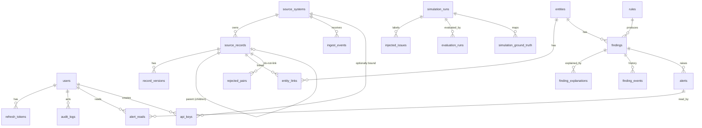

# 05 — Database Schema Document

**Engine:** PostgreSQL 16 · **Migrations:** Alembic only (never edit a merged migration; add a new one)
**Conventions**
- Table names: plural `snake_case`. Column names: `snake_case`.
- PK: `id uuid PRIMARY KEY DEFAULT gen_random_uuid()` unless stated.
- All timestamps `timestamptz`, stored UTC. `created_at timestamptz NOT NULL DEFAULT now()`; `updated_at` maintained by the app (or trigger).
- Enumerations are `text` with `CHECK` constraints (listed below).
- JSON data uses `jsonb`.
- Soft deletes only where stated (`is_deleted`).
- FK `ON DELETE` behavior is stated per relation.

## 1. ER diagram

## 2. Tables

### 2.1 `users`
| Column | Type | Constraints |
|--------|------|-------------|
| id | uuid | PK |
| email | citext | NOT NULL, UNIQUE |
| password_hash | text | NOT NULL |
| full_name | text | NOT NULL |
| role | text | NOT NULL, CHECK in (`admin`,`analyst`,`viewer`) |
| is_active | boolean | NOT NULL DEFAULT true |
| last_login_at | timestamptz | NULL |
| created_at / updated_at | timestamptz | NOT NULL |

Index: unique on `email` (citext).

### 2.2 `refresh_tokens`
| Column | Type | Constraints |
|--------|------|-------------|
| id | uuid | PK |
| user_id | uuid | NOT NULL, FK → users(id) ON DELETE CASCADE |
| family_id | uuid | NOT NULL (rotation family) |
| token_hash | text | NOT NULL, UNIQUE (sha256 of token) |
| expires_at | timestamptz | NOT NULL |
| revoked_at | timestamptz | NULL |
| replaced_by | uuid | NULL, FK → refresh_tokens(id) |
| created_at | timestamptz | NOT NULL |

Indexes: `(user_id)`, `(family_id)`, `(expires_at)`.

### 2.3 `api_keys`
| Column | Type | Constraints |
|--------|------|-------------|
| id | uuid | PK |
| name | text | NOT NULL |
| key_prefix | text | NOT NULL (first 8 chars, for display) |
| key_hash | text | NOT NULL, UNIQUE |
| source_system_id | uuid | NULL, FK → source_systems(id) ON DELETE SET NULL |
| created_by | uuid | NOT NULL, FK → users(id) |
| last_used_at | timestamptz | NULL |
| revoked_at | timestamptz | NULL |
| created_at | timestamptz | NOT NULL |

### 2.4 `source_systems`
| Column | Type | Constraints |
|--------|------|-------------|
| id | uuid | PK |
| key | text | NOT NULL, UNIQUE, CHECK in (`crm`,`billing`,`support`) *(extend CHECK via migration when adding systems)* |
| name | text | NOT NULL |
| is_active | boolean | NOT NULL DEFAULT true |
| reliability_weight | numeric(3,2) | NOT NULL DEFAULT 0.80, CHECK 0 ≤ x ≤ 1 |
| field_authority | jsonb | NOT NULL DEFAULT '{}' (field → 0..1) |
| status_mapping | jsonb | NOT NULL DEFAULT '{}' (raw status → canonical) |
| created_at / updated_at | timestamptz | NOT NULL |

### 2.5 `ingest_events` (durable queue)
| Column | Type | Constraints |
|--------|------|-------------|
| id | uuid | PK |
| batch_id | uuid | NOT NULL |
| source_system_id | uuid | NOT NULL, FK → source_systems(id) |
| record_type | text | NOT NULL, CHECK in (`account`,`subscription`,`invoice`,`ticket`) |
| external_id | text | NOT NULL |
| parent_external_id | text | NULL |
| event_type | text | NOT NULL, CHECK in (`upsert`,`delete`) |
| payload | jsonb | NOT NULL |
| source_updated_at | timestamptz | NOT NULL |
| idempotency_key | text | NOT NULL, UNIQUE |
| status | text | NOT NULL DEFAULT 'pending', CHECK in (`pending`,`processing`,`processed`,`failed`) |
| attempts | int | NOT NULL DEFAULT 0 |
| error | text | NULL (no PII) |
| received_at | timestamptz | NOT NULL DEFAULT now() |
| locked_at | timestamptz | NULL |
| processed_at | timestamptz | NULL |

Indexes:
- `idx_ingest_pending` on `(received_at)` **WHERE** `status = 'pending'` (queue polling)
- `idx_ingest_processing` on `(locked_at)` **WHERE** `status = 'processing'` (stuck re-queue)
- `idx_ingest_status_received` on `(status, received_at DESC)`
- unique `idempotency_key`

### 2.6 `source_records` (current state of each source record)
| Column | Type | Constraints |
|--------|------|-------------|
| id | uuid | PK |
| source_system_id | uuid | NOT NULL, FK → source_systems(id) |
| record_type | text | NOT NULL, CHECK as above |
| external_id | text | NOT NULL |
| parent_external_id | text | NULL |
| payload | jsonb | NOT NULL (raw, latest) |
| normalized | jsonb | NOT NULL (canonical fields) |
| record_hash | text | NOT NULL |
| version | int | NOT NULL DEFAULT 1 |
| source_created_at | timestamptz | NULL |
| source_updated_at | timestamptz | NOT NULL |
| is_deleted | boolean | NOT NULL DEFAULT false |
| ingested_at | timestamptz | NOT NULL DEFAULT now() |
| updated_at | timestamptz | NOT NULL DEFAULT now() |

Constraints: `UNIQUE (source_system_id, record_type, external_id)`.
Indexes: `(source_system_id, record_type, parent_external_id)`; GIN on `normalized jsonb_path_ops`; `(normalized->>'email_canonical')`; `(normalized->>'phone_e164')`; `(normalized->>'name_block')` (expression indexes for blocking).

### 2.6.1 `record_versions`
| Column | Type | Constraints |
|--------|------|-------------|
| id | uuid | PK |
| source_record_id | uuid | NOT NULL, FK → source_records(id) ON DELETE CASCADE |
| version | int | NOT NULL |
| payload | jsonb | NOT NULL |
| normalized | jsonb | NOT NULL |
| changed_fields | text[] | NOT NULL DEFAULT '{}' |
| source_updated_at | timestamptz | NOT NULL |
| out_of_order | boolean | NOT NULL DEFAULT false |
| created_at | timestamptz | NOT NULL DEFAULT now() |

Constraints: `UNIQUE (source_record_id, version)`. Index: `(source_record_id, source_updated_at DESC)`.

### 2.7 `entities`
| Column | Type | Constraints |
|--------|------|-------------|
| id | uuid | PK |
| entity_type | text | NOT NULL DEFAULT 'customer', CHECK in (`customer`) |
| canonical_name | text | NOT NULL |
| canonical_email | text | NULL |
| health | text | NOT NULL DEFAULT 'unknown', CHECK in (`consistent`,`inconsistent`,`unknown`) |
| open_findings_count | int | NOT NULL DEFAULT 0 |
| highest_severity | text | NULL, CHECK in (`low`,`medium`,`high`,`critical`) |
| detection_requested_at | timestamptz | NULL — durable detection queue: set when the entity needs its rules re-run, cleared by the detection loop (02 §3.3) |
| created_at / updated_at | timestamptz | NOT NULL |

Indexes: `(health)`, `(open_findings_count DESC)`, `idx_entities_detection_due` on `(detection_requested_at)` **WHERE** `detection_requested_at IS NOT NULL`, trigram GIN on `canonical_name` and `canonical_email` (`pg_trgm`) for search.

### 2.8 `entity_links`
| Column | Type | Constraints |
|--------|------|-------------|
| id | uuid | PK |
| entity_id | uuid | NOT NULL, FK → entities(id) ON DELETE CASCADE |
| source_record_id | uuid | NOT NULL, FK → source_records(id) ON DELETE CASCADE |
| match_confidence | numeric(4,3) | NOT NULL, CHECK 0 ≤ x ≤ 1 |
| match_method | text | NOT NULL (`blocking_score`,`external_ref`,`parent`,`manual`) |
| match_features | jsonb | NOT NULL DEFAULT '{}' |
| status | text | NOT NULL, CHECK in (`auto_matched`,`needs_review`,`confirmed`,`rejected`) |
| decided_by | uuid | NULL, FK → users(id) |
| decided_at | timestamptz | NULL |
| decision_note | text | NULL |
| created_at / updated_at | timestamptz | NOT NULL |

Constraints:
- `UNIQUE (entity_id, source_record_id)`
- **Partial unique** `UNIQUE (source_record_id) WHERE status <> 'rejected'` → a record is linked to at most one entity.
Indexes: `(entity_id)`, `(status, match_confidence DESC)`.

### 2.9 `rejected_pairs` (do-not-link memory)
| Column | Type | Constraints |
|--------|------|-------------|
| id | uuid | PK |
| record_a_id | uuid | NOT NULL, FK → source_records ON DELETE CASCADE |
| record_b_id | uuid | NOT NULL, FK → source_records ON DELETE CASCADE |
| rejected_by | uuid | NOT NULL FK → users |
| created_at | timestamptz | NOT NULL |

Constraint: `CHECK (record_a_id < record_b_id)`, `UNIQUE (record_a_id, record_b_id)`.

### 2.10 `rules`
| Column | Type | Constraints |
|--------|------|-------------|
| id | uuid | PK |
| key | text | NOT NULL, UNIQUE (`R001`…) |
| name | text | NOT NULL |
| description | text | NOT NULL |
| category | text | NOT NULL, CHECK in (`field_conflict`,`logic`,`temporal`,`structural`) |
| default_severity | text | NOT NULL, CHECK severity |
| severity | text | NOT NULL, CHECK severity (override; = default initially) |
| certainty | numeric(3,2) | NOT NULL, CHECK 0 ≤ x ≤ 1 |
| is_enabled | boolean | NOT NULL DEFAULT true |
| config | jsonb | NOT NULL DEFAULT '{}' |
| version | int | NOT NULL DEFAULT 1 |
| updated_by | uuid | NULL FK → users |
| created_at / updated_at | timestamptz | NOT NULL |

Seeded by migration/seed script from the code registry (R001–R015).

### 2.11 `findings`
| Column | Type | Constraints |
|--------|------|-------------|
| id | uuid | PK |
| entity_id | uuid | NOT NULL, FK → entities(id) ON DELETE CASCADE |
| rule_id | uuid | NOT NULL, FK → rules(id) |
| rule_key | text | NOT NULL (denormalized for filtering) |
| fingerprint | text | NOT NULL (64 hex) |
| title | text | NOT NULL |
| severity | text | NOT NULL, CHECK severity |
| status | text | NOT NULL DEFAULT 'open', CHECK in (`open`,`acknowledged`,`resolved`,`false_positive`,`auto_resolved`) |
| confidence | numeric(4,3) | NOT NULL, CHECK 0 ≤ x ≤ 1 |
| confidence_breakdown | jsonb | NOT NULL |
| priority_score | numeric(5,3) | NOT NULL |
| evidence | jsonb | NOT NULL |
| evidence_hash | text | NOT NULL |
| resolved_evidence_hash | text | NULL (evidence hash when a user resolved / marked false positive; used by reopen rules, 03 §M6) |
| explained_evidence_hash | text | NULL (evidence hash covered by the latest saved explanation; differs from `evidence_hash` → needs explanation, 03 §M8) |
| systems | text[] | NOT NULL (system keys involved) |
| first_detected_at | timestamptz | NOT NULL |
| last_detected_at | timestamptz | NOT NULL |
| resolved_at | timestamptz | NULL |
| resolved_by | uuid | NULL, FK → users |
| resolution_note | text | NULL |
| reopen_count | int | NOT NULL DEFAULT 0 |
| created_at / updated_at | timestamptz | NOT NULL |

Constraints: `UNIQUE (entity_id, fingerprint)`; `CHECK (jsonb_typeof(evidence) = 'object')`.
Indexes:
- `idx_findings_status_priority` `(status, priority_score DESC)`
- `idx_findings_entity` `(entity_id)`
- `idx_findings_rule_status` `(rule_key, status)`
- `idx_findings_open` `(severity, last_detected_at DESC)` **WHERE** `status IN ('open','acknowledged')`
- GIN on `systems`
- `idx_findings_created` `(first_detected_at)`
- `idx_findings_needs_explanation` `(priority_score DESC)` **WHERE** `status IN ('open','acknowledged') AND explained_evidence_hash IS DISTINCT FROM evidence_hash`

### 2.12 `finding_events` (history)
| Column | Type | Constraints |
|--------|------|-------------|
| id | uuid | PK |
| finding_id | uuid | NOT NULL, FK → findings(id) ON DELETE CASCADE |
| action | text | NOT NULL (`created`,`updated`,`acknowledged`,`resolved`,`false_positive`,`reopened`,`auto_resolved`,`explained`) |
| actor_id | uuid | NULL, FK → users(id) |
| note | text | NULL |
| data | jsonb | NOT NULL DEFAULT '{}' |
| created_at | timestamptz | NOT NULL DEFAULT now() |

Index: `(finding_id, created_at)`.

### 2.13 `finding_explanations`
| Column | Type | Constraints |
|--------|------|-------------|
| id | uuid | PK |
| finding_id | uuid | NOT NULL, FK → findings(id) ON DELETE CASCADE |
| input_hash | text | NOT NULL |
| model | text | NOT NULL (`template` for fallback) |
| prompt_version | text | NOT NULL |
| summary | text | NOT NULL |
| root_cause | text | NOT NULL |
| likely_correct_system | text | NOT NULL, CHECK in (`crm`,`billing`,`support`,`undetermined`) |
| suggested_actions | jsonb | NOT NULL (array of strings, ≤ 3) |
| caveats | text | NULL |
| is_fallback | boolean | NOT NULL DEFAULT false |
| raw_response | jsonb | NULL |
| latency_ms | int | NULL |
| created_at | timestamptz | NOT NULL DEFAULT now() |

Indexes: `(finding_id, created_at DESC)`, `idx_explanations_cache` `(input_hash, prompt_version, model, created_at DESC)` **WHERE** `is_fallback = false` — **not unique**, because "Regenerate" must be able to store a new row for the same input. *Latest explanation per finding = most recent by `created_at`.*

### 2.14 `alerts`
| Column | Type | Constraints |
|--------|------|-------------|
| id | uuid | PK |
| type | text | NOT NULL, CHECK in (`finding_created`,`finding_escalated`,`finding_resolved`,`link_needs_review`) |
| severity | text | NOT NULL, CHECK severity |
| title | text | NOT NULL |
| body | text | NOT NULL |
| finding_id | uuid | NULL, FK → findings(id) ON DELETE CASCADE |
| entity_id | uuid | NULL, FK → entities(id) ON DELETE CASCADE |
| link_id | uuid | NULL, FK → entity_links(id) ON DELETE CASCADE |
| dedup_key | text | NOT NULL (`finding:<fingerprint>:<type>` or `link:<link_id>:link_needs_review`, 03 §M7) |
| created_at | timestamptz | NOT NULL DEFAULT now() |

Indexes: `(created_at DESC)`, `(dedup_key, created_at DESC)`.

### 2.15 `alert_reads`
| Column | Type | Constraints |
|--------|------|-------------|
| alert_id | uuid | FK → alerts(id) ON DELETE CASCADE |
| user_id | uuid | FK → users(id) ON DELETE CASCADE |
| read_at | timestamptz | NOT NULL DEFAULT now() |

PK `(alert_id, user_id)`; index `(user_id)`.

### 2.16 `simulation_runs`
| Column | Type | Constraints |
|--------|------|-------------|
| id | uuid | PK |
| seed | int | NOT NULL |
| config | jsonb | NOT NULL |
| status | text | NOT NULL, CHECK in (`running`,`completed`,`stopped`,`failed`) |
| events_sent | int | NOT NULL DEFAULT 0 |
| events_total | int | NOT NULL DEFAULT 0 |
| started_by | uuid | NOT NULL FK → users |
| started_at | timestamptz | NOT NULL |
| ended_at | timestamptz | NULL |
| error | text | NULL |

### 2.17 `injected_issues` (ground-truth labels)
| Column | Type | Constraints |
|--------|------|-------------|
| id | uuid | PK |
| simulation_run_id | uuid | NOT NULL FK → simulation_runs ON DELETE CASCADE |
| issue_type | text | NOT NULL |
| ground_truth_key | text | NOT NULL (e.g., `GT-0231`) |
| expected_rule_key | text | NULL (NULL for decoys) |
| acceptable_rule_keys | text[] | NOT NULL DEFAULT '{}' (side-effect rules that count as neither TP nor FP, 03 §M9) |
| is_decoy | boolean | NOT NULL DEFAULT false |
| system_key | text | NOT NULL, CHECK in (`crm`,`billing`,`support`) |
| details | jsonb | NOT NULL |
| injected_at | timestamptz | NOT NULL DEFAULT now() |

Indexes: `(simulation_run_id, issue_type)`, `(ground_truth_key)`.

### 2.17.1 `simulation_ground_truth` (which source record belongs to which real customer)
| Column | Type | Constraints |
|--------|------|-------------|
| simulation_run_id | uuid | NOT NULL FK → simulation_runs ON DELETE CASCADE |
| system_key | text | NOT NULL, CHECK in (`crm`,`billing`,`support`) |
| record_type | text | NOT NULL, CHECK as `source_records` |
| external_id | text | NOT NULL |
| ground_truth_key | text | NOT NULL |

PK `(simulation_run_id, system_key, record_type, external_id)`. Index: `(simulation_run_id, ground_truth_key)`. Written by the simulation runner before it emits the record's first event; never sent through ingest.

### 2.18 `evaluation_runs`
| Column | Type | Constraints |
|--------|------|-------------|
| id | uuid | PK |
| simulation_run_id | uuid | NOT NULL FK → simulation_runs ON DELETE CASCADE |
| precision | numeric(5,4) | NOT NULL |
| recall | numeric(5,4) | NOT NULL |
| f1 | numeric(5,4) | NOT NULL |
| true_positives / false_positives / false_negatives / ignored | int | NOT NULL |
| matching | jsonb | NOT NULL DEFAULT '{}' (`auto_precision`, `recall_auto_or_review`, `true_pairs`) |
| by_type | jsonb | NOT NULL |
| misses | jsonb | NOT NULL |
| false_positive_findings | jsonb | NOT NULL |
| created_at | timestamptz | NOT NULL DEFAULT now() |

### 2.19 `audit_logs`
| Column | Type | Constraints |
|--------|------|-------------|
| id | uuid | PK |
| actor_id | uuid | NULL, FK → users(id) ON DELETE SET NULL |
| action | text | NOT NULL (`user.login`,`finding.transition`,`rule.update`,`link.confirm`,…) |
| target_type | text | NOT NULL |
| target_id | text | NULL |
| metadata | jsonb | NOT NULL DEFAULT '{}' (no PII values) |
| created_at | timestamptz | NOT NULL DEFAULT now() |

Indexes: `(created_at DESC)`, `(actor_id, created_at DESC)`, `(action)`.

## 3. Extensions required
`pgcrypto` (or PG ≥ 13 built-in `gen_random_uuid`), `citext`, `pg_trgm`. Enabled in the first migration.

## 4. Relationship summary
| From | To | Cardinality | On delete |
|------|----|-------------|-----------|
| source_records | source_systems | N:1 | RESTRICT |
| record_versions | source_records | N:1 | CASCADE |
| entity_links | entities | N:1 | CASCADE |
| entity_links | source_records | N:1 | CASCADE |
| rejected_pairs | source_records (×2) | N:1 | CASCADE |
| findings | entities | N:1 | CASCADE |
| findings | rules | N:1 | RESTRICT |
| finding_events | findings | N:1 | CASCADE |
| finding_explanations | findings | N:1 | CASCADE |
| alerts | findings / entities / entity_links | N:1 | CASCADE |
| alert_reads | alerts, users | N:1 | CASCADE |
| injected_issues | simulation_runs | N:1 | CASCADE |
| simulation_ground_truth | simulation_runs | N:1 | CASCADE |
| evaluation_runs | simulation_runs | N:1 | CASCADE |
| refresh_tokens | users | N:1 | CASCADE |
| api_keys | source_systems | N:1 | SET NULL |
| audit_logs | users | N:1 | SET NULL |

Child→parent record relation is logical (`parent_external_id` within the same `source_system_id`), resolved by services, not a DB FK, because events can arrive out of order.

## 5. Integrity rules enforced by the application (tested)
1. A record belongs to at most one non-rejected entity (also DB-enforced).
2. `entities.open_findings_count` and `highest_severity` equal the aggregate of that entity's `open|acknowledged` findings (updated in the same transaction).
3. `entities.health` = `inconsistent` if any open/ack finding with severity ≥ medium; otherwise `consistent` if the entity has ≥ 2 linked **account** records; otherwise `unknown`. (Only low-severity findings → still `consistent`.)
4. `source_records.version` equals max `record_versions.version` for in-order updates.
5. Ingest `idempotency_key` uniqueness prevents duplicate processing.
6. An entity with `detection_requested_at` set is eventually processed and cleared (no request older than 60 s in a healthy system).

## 6. Initial seed data
**Bootstrap (runs on every API startup, idempotent — not in migrations):**
- `source_systems`: `crm`, `billing`, `support` with default authority/status mappings (03_MODULES §M1, §M2) — inserted only if missing; admin edits are kept. (T-009)
- `rules`: synced from the code registry (03 §M4 "Registry → table sync"). (T-019)
- First admin user from `ADMIN_EMAIL` / `ADMIN_PASSWORD` if the `users` table is empty. (T-007)

**Demo data (`make seed`, T-041):** a completed simulation run with evaluation. Never runs automatically.

## 7. Migration rules
- One logical change per migration, named `YYYYMMDDHHMM_<slug>.py`.
- Every migration is reversible (`downgrade`) except destructive data changes (document why).
- Never edit a migration that has been merged to `main`.
- Migration tasks are **exclusive**: only one agent at a time may add migrations (see 07_AGENT_RULES §Shared files).
- CI runs `alembic upgrade head` on an empty DB and `alembic check` for model drift.

## 8. Query/Index justification (hot paths)
| Query | Index |
|-------|-------|
| Worker claims pending events | `idx_ingest_pending` |
| Blocking candidates by email/phone | expression indexes on `source_records.normalized` |
| Findings list (status + sorted by priority) | `idx_findings_status_priority` |
| Dashboard open findings by severity | `idx_findings_open` |
| Entity detail (links, findings) | `entity_links(entity_id)`, `findings(entity_id)` |
| Alert dedup lookup | `(dedup_key, created_at DESC)` |
| Entity search | trigram GIN on name/email |
