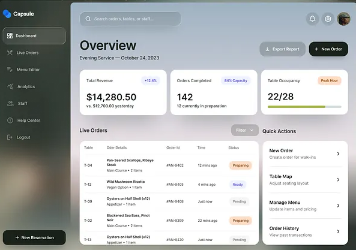

# 06 — UI Style Guide

**Version 2 (2026-10-10).** Reference design: the "Capsule" operations dashboard supplied by the product owner. RealitySync adopts its visual language — a dark frosted sidebar and a large light frosted work panel floating over a soft, blurred scene; solid white cards with generous radii; one dark primary button; soft tinted pills for status — and re-maps it to data-consistency content. It replaces the v1 "Crextio" direction (D-047).



*Reference: `docs/assets/reference-dashboard-v2.png`. Agents MUST open this image before building any page. The v1 image `reference-dashboard.png` is kept only for history.*

---

## 1. Design principles

1. **Two layers of glass, one layer of paper.** The scene (background) → glass (sidebar, work panel, top-bar controls) → paper (solid white cards that hold data). Data never sits directly on glass; glass never sits on paper.
2. **Calm ink, quiet tints.** Text and the primary action are near-black ink. Meaning is carried by soft tinted pills (peach, indigo, sky, moss, rose) with a dark text of the same hue — never by saturated fills.
3. **The number is the hero.** Each KPI card has one big medium-weight number, a short label above it, one context line below it and at most one chip.
4. **One primary action per view.** Exactly one dark button (`Button variant="primary"`) per page header; everything else is secondary glass or ghost.
5. **Evidence beside every claim.** Whenever AI text, a score or a risk level is shown, the underlying evidence (or the trail) is one click away and visibly linked.
6. **Motion explains, never decorates repeated actions.** See §8: fast, ease-out, interruptible; no animation on keyboard-driven or high-frequency actions.
7. **Accessible by default.** Meaning is never conveyed by color alone (pills carry text, severity carries a shape); glass always has a solid fallback.

## 2. Color tokens

Define as CSS variables in `src/styles/tokens.css`; expose in Tailwind (`tailwind.config.ts`). **Never use raw hex values in components.**

### 2.1 Ink and paper
| Token | Hex | Usage |
|-------|-----|-------|
| `--ink-950` | `#121412` | Primary button fill, headings, big numbers |
| `--ink-900` | `#1C1F1C` | Body text on paper |
| `--ink-700` | `#3A3E3A` | Strong secondary text, icons on paper |
| `--ink-500` | `#6A6F69` | Secondary text, table headers, sub-lines |
| `--ink-400` | `#9A9F98` | Placeholders, disabled, decorative only |
| `--ink-200` | `#E3E6E1` | Borders on paper, progress track |
| `--ink-100` | `#F1F3EF` | Row dividers, hover wash on paper, neutral pill bg |
| `--paper` | `#FFFFFF` | Cards |
| `--on-dark` | `#F4F6F3` | Text on the sidebar / dark button |
| `--on-dark-muted` | `rgba(244,246,243,0.62)` | Inactive sidebar items |

### 2.2 Tints (pills, badges, chips)
Each tint is a pair: background + text of the same hue. Text on its own tint passes WCAG AA (≥ 4.5:1).

| Token pair | Bg | Text | Used for |
|------------|----|------|----------|
| `peach` | `#FCE6D6` | `#A8521E` | High severity, `warning` risk, "Preparing"-style in-progress states |
| `rose` | `#FBE1DE` | `#B3352B` | Critical severity, `critical` risk, errors |
| `amber` | `#FAEFCB` | `#8A6100` | Medium severity, `pending` expectation |
| `indigo` | `#E9E8FD` | `#4B45C2` | Positive deltas, AI-generated badge, `watch` risk |
| `sky` | `#E1ECFD` | `#2E62C4` | Info, "Ready"/resolved-by-system states, links |
| `moss` | `#E4EFD3` | `#4C6A16` | Success, consistent, resolved |
| `neutral` | `#F1F3EF` | `#5A5F59` | Low severity, pending/unknown, `cannot_assess` |

### 2.3 Accent
| Token | Hex | Usage |
|-------|-----|-------|
| `--moss-500` | `#8DB33A` | Progress fills, sparkline highlight, "live" dot |
| `--moss-600` | `#73952A` | Progress fill hover / pressed |

The accent is never used for text and never as a button fill.

### 2.4 Scene and glass
| Token | Value | Usage |
|-------|-------|-------|
| `--scene` | layered blurred gradient (§11) in sage, stone and charcoal | Fixed full-viewport background |
| `--glass-dark` | `rgba(22,25,22,0.46)` + `blur(28px) saturate(140%)` | Sidebar, toasts on scene |
| `--glass-dark-border` | `rgba(255,255,255,0.10)` | Sidebar border |
| `--glass-dark-active` | `rgba(255,255,255,0.12)` + border `rgba(255,255,255,0.16)` | Active sidebar item |
| `--glass-panel` | `rgba(242,244,240,0.74)` + `blur(32px) saturate(150%)` | The work panel |
| `--glass-panel-border` | `rgba(255,255,255,0.55)` | Work panel border |
| `--glass-control` | `rgba(255,255,255,0.46)` + border `rgba(255,255,255,0.6)` | Search, icon buttons, secondary buttons, filter button on the panel |

**Fallback** (no `backdrop-filter`, or `prefers-reduced-transparency: reduce`): sidebar `#232723`, panel `#EEF0EC`, controls `#FFFFFF`.

The scene is a generated abstract image (no stock photo). A product-owner-supplied photo may replace it later through the single `--scene` token; it must be blurred ≥ 40px and dimmed so glass contrast rules still pass.

### 2.5 Contrast rules (WCAG AA)
- `--ink-900`/`--ink-950` on `--paper`, `--glass-panel` and `--glass-control`: ✅
- `--on-dark` on `--glass-dark` (over the scene) and on `--ink-950`: ✅ — the scene is dimmed so this holds at every point.
- Tint text on its own tint bg: ✅ (pairs in §2.2 only; do not mix pairs).
- `--ink-400` is for placeholders/decoration only; readable secondary text uses `--ink-500` or darker.

## 3. Typography

**Family:** `Inter` variable (self-hosted via `@fontsource-variable/inter`; no CDN). Fallback: `ui-sans-serif, system-ui, -apple-system, "Segoe UI", sans-serif`. `font-feature-settings: "cv11", "ss01"`; numbers in tables, KPIs and timestamps use `tabular-nums`.

| Token | Size / line-height | Weight | Tracking | Use |
|-------|-------------------|--------|----------|-----|
| `display` | 44 / 48 | 500 | −0.035em | Page title ("Overview") |
| `kpi` | 36 / 40 | 500 | −0.025em | KPI number ("142", "22/28") |
| `h2` | 20 / 28 | 600 | −0.01em | Section titles ("Live findings", "Quick actions") |
| `h3` | 15 / 22 | 600 | 0 | Card titles, list item titles |
| `body` | 14 / 20 | 400 | 0 | Default |
| `body-strong` | 14 / 20 | 500 | 0 | Table primary cell, nav items |
| `small` | 13 / 18 | 400 | 0 | Sub-lines, secondary cells |
| `caption` | 12 / 16 | 500 | 0.005em | Table headers, pill text, timestamps |

Rules
- **Sentence case everywhere.** No ALL CAPS, no letter-spaced eyebrows.
- Weight 500–600 for anything ≤ 20px that must be scanned; never 300.
- Line length ≤ 70 characters for paragraphs (AI explanations, caveats).

## 4. Spacing, radius, elevation, grid

**Spacing scale (4px base):** `4, 8, 12, 16, 20, 24, 32, 40, 48, 64`.
| Context | Value |
|---------|-------|
| Viewport inset around sidebar and panel | 12 |
| Panel inner padding | 32 (desktop) / 20 (tablet) / 16 (mobile) |
| Card inner padding | 20 |
| Gap between cards | 16 |
| Section vertical gap | 32 |
| Max content width inside the panel | 1360 |

**Radius**
| Token | px | Use |
|-------|----|-----|
| `r-panel` | 28 | Work panel, sidebar |
| `r-card` | 18 | Cards, drawer, dialog |
| `r-control` | 12 | Buttons, inputs, search, sidebar items, filter button |
| `r-pill` | 999 | Pills, badges, progress bars, avatar, icon buttons |

**Elevation**
| Token | Value |
|-------|-------|
| `shadow-card` | `0 1px 2px rgba(18,20,18,0.04), 0 8px 24px rgba(18,20,18,0.06)` |
| `shadow-raised` | `0 2px 4px rgba(18,20,18,0.06), 0 16px 40px rgba(18,20,18,0.12)` (hovered interactive card, popovers) |
| `shadow-panel` | `0 24px 80px rgba(10,12,10,0.25)` (work panel over the scene) |
| `shadow-button` | `0 1px 0 rgba(255,255,255,0.12) inset, 0 6px 16px rgba(18,20,18,0.25)` (primary button) |

**Grid:** 12 columns inside the panel, 16px gutter. Breakpoints: `sm 640 · md 768 · lg 1024 · xl 1280 · 2xl 1536`.

## 5. App shell and navigation

```
┌ scene ─────────────────────────────────────────────────────────────────────────────┐
│ ┌ sidebar (glass-dark, 248) ┐ ┌ work panel (glass-panel, r-panel) ─────────────────┐ │
│ │ ◆ RealitySync             │ │ [⌕ Search customers, findings, records…]   🔔 ⚙ (PS)│ │
│ │ ▣ Overview   ← active     │ │                                                    │ │
│ │ ◎ Findings          12    │ │ Overview                    [⇩ Export] [+ New inv.]│ │
│ │ ◉ Customers               │ │ Live consistency — 10 Oct 2026                     │ │
│ │ ⟲ Investigations          │ │ ┌ KPI ┐ ┌ KPI ┐ ┌ KPI ┐ ┌ KPI ┐                     │ │
│ │ ⇄ Link review        9    │ │ ┌ Live findings (table) ────────┐ ┌ Quick actions ┐ │ │
│ │ ◔ Alerts                  │ │ │                               │ │ ›  ›  ›  ›    │ │ │
│ │ ── Admin                  │ │ └───────────────────────────────┘ └───────────────┘ │ │
│ │ ≡ Rules  ▤ Systems  ▶ Sim │ │                                                    │ │
│ │ ⚙ Settings  ⇥ Sign out    │ │                                                    │ │
│ │ [ + New investigation ]   │ │                                                    │ │
│ └───────────────────────────┘ └────────────────────────────────────────────────────┘ │
└────────────────────────────────────────────────────────────────────────────────────┘
```

- **Sidebar** (fixed, full height minus the 12px inset, `--glass-dark`, `r-panel`): logo mark + wordmark "RealitySync"; nav items (icon 20 + label, height 40, `r-control`); the active item uses `--glass-dark-active` and a moving indicator (§8); items may show a count pill (Findings = open, Link review = needs review). Group "Admin" (Rules, Systems, Simulation) visible to admins only; Link review analyst+. Bottom: Settings, Sign out, then the **primary action** button "New investigation" (analyst+; viewers see nothing there).
- **Work panel** (`--glass-panel`, `r-panel`, `shadow-panel`, scrolls internally): top bar with search (glass control, `⌘K`/`Ctrl K` hint), connection dot, bell (unread count), settings icon button, avatar (initials, menu: profile, users (admin), sign out).
- **Page header:** `display` title + `small` subtitle (context or date) on the left; secondary glass button(s) and the one primary button on the right.
- **Tablet (768–1279):** sidebar collapses to a 72px icon rail (labels in tooltips).
- **Mobile (< 768):** no sidebar; the panel fills the viewport with an 8px inset; a glass bottom bar holds Overview, Findings, Customers, Alerts and a "More" sheet.
- Routes are listed in 02 §3.1.

## 6. Components

All primitives live in `src/components/ui/` and are the **only** place raw styles for these elements are defined. Names match the v1 list where the job is the same.

| Component | Spec |
|-----------|------|
| `Scene` | Fixed background layer (`--scene` + a 3% grain overlay). Rendered once in the app shell. |
| `Sidebar` / `NavItem` | §5. Active indicator is one shared element that moves between items. Count pill: `neutral` tint on dark (white 12% bg, `--on-dark` text). |
| `Panel` | The work panel surface. |
| `Card` | `--paper`, `r-card`, `shadow-card`, padding 20. Header row: `h3` (or `small` label for KPIs) left, optional chip/action right. Interactive cards lift to `shadow-raised` on hover (pointer devices only). |
| `KpiCard` | Label (`small`, `--ink-500`) + optional `Pill` top-right; `kpi` number (count-up on first load, §8); context line (`small`); optional `ProgressBar`. |
| `Button` | Height 40 (sm 32), `r-control`, `body-strong`, icon 16 left. **primary**: `--ink-950` fill, `--on-dark` text, `shadow-button`. **secondary**: `--glass-control` (on panel) or `--paper` with `--ink-200` border (on cards), `--ink-900` text. **ghost**: no fill, hover `--ink-100`. **danger**: `--rose-fg` text on `--rose-bg`. **destructive** (confirm button inside a `Dialog` only): `--rose-fg` fill, white text. Disabled 45% opacity. |
| `IconButton` | 40px circle, `--glass-control`; sm 32. Always `aria-label`; tooltip with the same text. |
| `Pill` | Height 24, padding 0 10, `r-pill`, `caption`, a tint pair from §2.2; optional leading 6px dot or 12px icon. |
| `SeverityBadge` | `Pill` + shape icon (critical ▲ rose, high ◆ peach, medium ● amber, low ○ neutral) + label. |
| `RiskBadge` | `Pill` with gauge icon + level ("Warning") **and** the confidence as a second segment ("· 100%"); levels: low moss, watch indigo, warning peach, critical rose. Never shown without confidence (§7.8). |
| `StatusPill` | Finding status: open neutral-dark, acknowledged sky, resolved moss, false positive neutral, auto-resolved moss outline. Changes crossfade (§8). |
| `ConfidenceMeter` | 20px ring + percentage `tabular-nums`; ring stroke `--ink-950` on `--ink-200` track. Tooltip shows breakdown (link / rule / evidence / recency). |
| `ProgressBar` | Height 8, `r-pill`, track `--ink-200`, fill `--moss-500`; value text outside the bar. Grows in on first view (§8). |
| `SystemChip` | `Pill` neutral with system icon + name (CRM, Billing, Support). |
| `DataTable` | Inside a `Card` (padding 0, header padding 20). Header `caption` `--ink-500`, height 40; rows height 56, divider `--ink-100`, hover `--ink-100` wash; primary cell `body-strong`, secondary line `small` `--ink-500`; ids in `caption` `tabular-nums`; sortable headers with chevron; sticky header when scrolling. No zebra. |
| `ActionList` | `Card` of stacked rows (title `h3`, sub-line `small`, trailing chevron 16), divider between rows, row hover `--ink-100`, chevron nudges 2px right on hover. ("Quick actions" in the reference.) |
| `LiveFeed` | `Card` with a pulsing moss "live" dot in the header; items: icon circle 32 (tint by severity) + title + time; new items enter per §8. |
| `DiffRow` | field · CRM · Billing · Support; differing cells use the `peach` tint with a 2px peach-text left border; matching cells plain. |
| `TrailView` | Three stacked groups (§7.8): Facts (system chip, record id, recorded time), Inferences (each lists the fact ids it uses as small linked chips), Conclusion (severity/risk + confidence). Hovering a fact highlights the inferences that use it. |
| `Avatar` | Circle, initials, `--ink-100` bg + `--ink-700` text (entities) or soft moss gradient (current user). |
| `Search` / `Input` / `Select` | Height 40, `r-control`; on the panel `--glass-control`, on cards `--paper` + `--ink-200` border; focus ring §6.1. |
| `Tabs` | Segmented control on `--ink-100`, active segment `--paper` + `shadow-card`, sliding indicator (§8). |
| `Drawer` | Right side, 560px (full screen on mobile), `--paper`, `r-card` on the left corners, `shadow-raised`; scrim `rgba(18,20,18,0.28)`. |
| `Dialog` | Centered, max 480, `--paper`, `r-card`; confirmations and one-time secrets. Esc closes. |
| `Toast` | `--glass-dark` card, `--on-dark` text, bottom-right; severity icon; critical toasts persist; swipe/× to dismiss. |
| `Tooltip` | `--ink-950` bg, `--on-dark` `caption`, radius 8, 400 ms delay on first hover, instant for subsequent ones (§8). |
| `Skeleton` | `--ink-100` block with a soft shimmer (off under reduced motion). |
| `EmptyState` / `ErrorState` | Icon circle (neutral / rose tint) + one sentence + one action. |
| `Switch` / `Slider` | Radix. Switch track 40×24, off `--ink-200`, on `--ink-950`. Slider track `--ink-200`, fill `--moss-500`, thumb 20px `--paper` with `shadow-card`. |
| `Chart` | Recharts styled with tokens: lines/bars `--ink-950` and `--moss-500`, gridlines `--ink-100`, tooltip = `Tooltip` style, axis labels `caption` `--ink-500`. |

### 6.1 Interaction states
- Hover (pointer devices only, `@media (hover: hover) and (pointer: fine)`): paper rows/cards wash `--ink-100` or lift; glass controls +12% white; primary button lightens to `--ink-700`.
- Pressed: `scale(0.97)` on buttons, icon buttons, nav items and action rows.
- Focus-visible: `outline: 2px solid var(--ink-950); outline-offset: 2px` on light surfaces; `--on-dark` on the sidebar.
- Selected table row: `--ink-100` fill + 2px `--ink-950` left inset.

## 7. Page layouts

### 7.1 Overview (dashboard) — reference mapping

| Reference | RealitySync |
|-----------|-------------|
| "Overview / Evening Service — date" | "Overview" / "Live consistency — {date}" (+ "{n} new findings since you left" when > 0) |
| Export Report · New Order | "Export report" (secondary, findings CSV, analyst+) · **"New investigation"** (primary, analyst+) |
| Total Revenue $14,280.50, +12.4% chip, "vs. yesterday" | **Open findings** 62 · chip "+8 today" (indigo) · "14 high or critical" |
| Orders Completed 142, "84% Capacity" chip | **Consistency score** 91.4% · chip "▲ 1.2 pts" · `ProgressBar` |
| Table Occupancy 22/28, "Peak Hour" chip, progress bar | **Customers at risk** 7 · chip "3 critical" (rose) · "avg. confidence 92%" |
| — | **Explained by AI** 96% · chip "Gemini" or "Templates" · "38 of 40 active findings" |
| Live Orders table (Table · Details · Id · Time · Status) + Filter | **Live findings** `DataTable`: Severity · Finding (title + rule/customer sub-line) · Systems · Confidence · Detected · Status; Filter button (severity/status/system); row → finding drawer |
| Quick Actions (New Order, Table Map, Manage Menu, Order History) | **Quick actions** `ActionList`: Start an investigation · Open the Time Machine · Review links ({n} waiting) · Run a simulation (admin) |
| — | Below: **Findings this week** (`Chart`, created vs resolved) · **System health** (CRM/Billing/Support rows with open issues and feed freshness) · **Live feed** |

KPI grid: 4 columns ≥ xl, 2 columns md–lg, 1 column mobile. Live findings spans 8 of 12 columns ≥ lg; Quick actions + Live feed 4.

### 7.2 Findings
Page header "Findings" + "Export CSV" (secondary). Toolbar: search, filter pills (status, severity, system, rule, min confidence), sort select, bulk-action button. `DataTable` columns: severity · title · customer · systems · confidence · status · detected (relative) · SLA flag. Row click → **Drawer**: header (title, severity, status, confidence) → Evidence (`DiffRow`s + timestamps) → **Trail** (`TrailView`) → AI explanation (badge "AI-generated" indigo or "Template" neutral, cited facts highlighted, "Regenerate" ghost) → History → sticky action bar: Acknowledge (secondary) · Resolve (primary) · Mark as false positive (ghost, note required).

### 7.3 Customer (entity) detail
Header: avatar, canonical name/email, health pill, `RiskBadge`, "Open Time Machine" (secondary) and "Investigate" (primary, analyst+). Row of three system cards (CRM / Billing / Support) listing normalized fields, differing values tinted; children under each. Right column: open findings, expectations (pending / cannot assess, §7.8), timeline. Link rows show match confidence with an expandable feature breakdown.

### 7.4 Link review
Queue on the left (score descending); two records side by side on the right with matching/different fields; "Same customer" (primary) / "Not the same" (secondary). Keyboard: `Y` confirm, `N` reject, `J/K` navigate — **no animation** on keyboard navigation (§8).

### 7.5 Alerts
List grouped by day inside a `Card`; unread rows have a moss dot; filters by type/severity; "Mark all as read".

### 7.6 Rules / Systems / Simulation / Evaluation (admin)
- Rules: `DataTable` with Switch, severity Select, config drawer generated from `config_schema`.
- Systems: one card per system (reliability Slider, field-authority editor, feed watermark "last data recorded {relative}") + "Failed events" table with Retry.
- Simulation: form card (seed, customers, anomaly rate, speed, anomaly types, history days, scenario rate, feed outage) + run progress card + "Simulate drift" (secondary).
- Evaluation: KPI cards for precision / recall / F1, matching and investigation metrics (03 §M9), per-type bars, misses and false positives.

### 7.7 Settings
`Tabs`: Profile (incl. change password) · Users (admin) · API keys (admin; secret shown once in a `Dialog`) · Audit log (admin).

### 7.8 Time Machine, risk and investigations
Content rules (binding):
- **Risk is never shown without confidence** (`RiskBadge`). Never merge them into one number or one color.
- Risk level labels: "Low", "Watch", "Warning", "Critical" (tints in §6 `RiskBadge`).
- **Missing evidence wording** (FR-MEV-004): "Payment unconfirmed", "No response recorded", "Cannot assess — no Billing data recorded since {date}". Never "not paid", "ignored", "never responded".
- Expectation outcomes: `pending` → "Waiting until {deadline}" (amber); `cannot_assess` → "Cannot assess" (neutral); shown in a separate group from findings.
- **Trail:** groups labelled "Facts (from source systems)", "What RealitySync inferred" and "Conclusion"; every fact shows system, record id and recorded time; AI explanations highlight their cited facts.
- **Investigation result:** the API caveat is always shown on screen and in exports, unedited and not collapsible. Outcome copy: `crossed` → "RealitySync could have flagged this {lead time} before the incident"; `never_crossed` → "With the data recorded before the incident, RealitySync would not have flagged this".

Layouts:
- **Time Machine (customer as of T)** = the customer detail page in "as-of mode": a persistent dark glass banner at the top of the panel "Viewing as of {date time UTC} — data recorded by then, today's rules" with a date-time scrubber (slider over the customer's version times, snapping to them) and "Back to now". Records not linkable yet appear in a muted "Not yet linkable at this time" group. Values that differ from today show a small "changed since" sky pill.
- **Investigations list:** `DataTable` (customer · incident · outcome pill · lead time · status · started).
- **Investigation result:** header with outcome sentence (above) as the page subtitle; caveat card directly under the header (amber tint border, not dismissible); **replay chart** (risk score over checkpoints, threshold line at the warning level, crossing point marked with a dot and a label "{date} · {lead time} before"); below, "At the crossing": `RiskBadge`, signal breakdown (four rows with value bars) and the `TrailView`; checkpoint list on demand.

## 8. Motion

Principles (from the design-engineering review, D-048): every animation has a purpose (feedback, spatial consistency, state change, preventing a jarring change); UI motion is fast and starts fast; frequent or keyboard-driven actions do not animate; only `transform`, `opacity` (and `filter` for short blur crossfades) are animated.

**Tokens** (`tokens.css`)
| Token | Value | Use |
|-------|-------|-----|
| `--ease-out` | `cubic-bezier(0.23, 1, 0.32, 1)` | Enters, presses, popovers (default) |
| `--ease-in-out` | `cubic-bezier(0.77, 0, 0.175, 1)` | Elements moving on screen (nav indicator, tab indicator) |
| `--ease-drawer` | `cubic-bezier(0.32, 0.72, 0, 1)` | Drawer, sheets |
| `--dur-press` | 140ms | Press feedback |
| `--dur-fast` | 180ms | Hover colour, tooltips, popovers, dropdowns |
| `--dur-base` | 240ms | Indicators, crossfades, list item enter |
| `--dur-slow` | 320ms | Drawer/sheet enter (exit 200ms) |

Never use `ease-in` for UI. Never animate from `scale(0)` (start at `scale(0.96)` + opacity 0). Never `transition: all`.

**Catalogue** (the only animations allowed; anything new needs a line here)
| Where | What | How |
|-------|------|-----|
| Buttons, icon buttons, nav items, action rows | Press feedback | `scale(0.97)`, `--dur-press`, `--ease-out` |
| Sidebar active indicator, `Tabs` | Spatial consistency between items | One shared element slides to the new item, `--dur-base`, `--ease-in-out` (spring `duration 0.3, bounce 0` with Motion) |
| Popovers, dropdowns, Select | Enter/exit from the trigger | `scale(0.96)→1` + opacity, `transform-origin` = trigger side, `--dur-fast`; exit 120ms |
| Tooltip | Enter | 400ms delay on first hover, then instant for neighbours; 125ms opacity + `scale(0.97)` |
| Drawer | Enter from the right | `translateX(100%)→0`, `--dur-slow`, `--ease-drawer`; exit 200ms `--ease-out`; scrim opacity |
| Dialog | Enter | `scale(0.96)→1` + opacity, 200ms, centered origin |
| Toast | Enter/exit bottom-right | CSS transition (interruptible) `translateY(100%)→0` + opacity, 360ms `ease`; swipe to dismiss with velocity check (> 0.11 px/ms) |
| First load of Overview (once per session) | Orchestration | Header, KPI cards, then cards fade + `translateY(8px)` with 40ms stagger, 300ms `--ease-out`; KPI numbers count up 700ms `--ease-out`; progress bars grow `scaleX` from the left 700ms. Never blocks interaction. |
| Live findings table / live feed | New item arrives | Row enters (opacity + `translateY(-6px)`, `--dur-base`) and its background fades from `--moss` tint to transparent over 1.2s. If the user has scrolled down, rows are not inserted above the viewport; a "{n} new" pill appears instead. |
| `StatusPill`, KPI value change | State change | Crossfade 200ms with `filter: blur(2px)` at the midpoint |
| Live dot | "Connected" | Soft pulse (opacity + ring `scale` 1→1.8) every 2s; stops when disconnected |
| Investigation replay chart | Explanation (rare) | Line draws left→right 900ms `--ease-in-out` on first render, then the crossing dot appears with a 200ms pop |
| Time Machine scrubber | Direct manipulation | Values update instantly while dragging (no animation); changed values flash the sky tint 600ms after release |

Not animated: page navigation (instant), keyboard navigation (`J/K`, `Y/N`, ⌘K open/close), table sorting/filtering (content swaps instantly; a 2px top progress line shows loading), hover on dense table rows (colour only, no movement).

**Reduced motion** (`prefers-reduced-motion: reduce`): no movement — counts show final values, indicators jump, drawers/toasts fade only (150ms), shimmer and pulse off. Opacity crossfades stay.

**Implementation:** CSS transitions first (interruptible, off the main thread). The `motion` library (D-047) is used only for shared-layout indicators, presence (exit) animations, the count-up and gesture/drag (toast swipe, scrubber); with Motion, animate `transform` strings for hardware acceleration where it matters.

## 9. Writing style (microcopy)
- Sentence case, plain verbs, active voice. Buttons name the result: "Resolve finding", "Confirm match", "Start investigation".
- Keep action names consistent: button "Resolve" → toast "Finding resolved".
- Errors say what happened and how to fix it; no apologies: "Couldn't load findings. Check your connection and retry."
- Empty states invite action: "No findings yet. Start a simulation to generate data."
- Use user language: "Customer", "mismatch", "match confidence" — not "entity resolution" or "idempotency". The UI says **Customers** for entities.
- AI text is always labeled and never the only explanation; evidence is adjacent.

## 10. Accessibility checklist (per component/page)
- [ ] Keyboard reachable in logical order; no keyboard traps; Esc closes drawers/dialogs/popovers.
- [ ] Visible focus on every interactive element (incl. on the dark sidebar).
- [ ] `aria-label` on icon buttons; `aria-live="polite"` for the live feed and live table (critical = `assertive`).
- [ ] Tables use semantic `<table>` with scope headers.
- [ ] Contrast verified on glass over the brightest point of the scene; severity/risk have shape + text.
- [ ] Touch targets ≥ 44px on touch devices (controls grow from 40 to 44 under `pointer: coarse`).
- [ ] Reduced motion and reduced transparency respected.

## 11. Implementation snippets

`src/styles/tokens.css` (excerpt — the full file is the source of truth once T-005 lands)
```css
:root {
  --ink-950:#121412; --ink-900:#1C1F1C; --ink-700:#3A3E3A; --ink-500:#6A6F69; --ink-400:#9A9F98;
  --ink-200:#E3E6E1; --ink-100:#F1F3EF; --paper:#FFFFFF; --on-dark:#F4F6F3; --on-dark-muted:rgba(244,246,243,.62);
  --moss-500:#8DB33A; --moss-600:#73952A;
  --peach-bg:#FCE6D6; --peach-fg:#A8521E; --rose-bg:#FBE1DE; --rose-fg:#B3352B; --amber-bg:#FAEFCB; --amber-fg:#8A6100;
  --indigo-bg:#E9E8FD; --indigo-fg:#4B45C2; --sky-bg:#E1ECFD; --sky-fg:#2E62C4; --moss-bg:#E4EFD3; --moss-fg:#4C6A16;
  --neutral-bg:#F1F3EF; --neutral-fg:#5A5F59;
  --scene:
    radial-gradient(60% 50% at 18% 22%, #9AA58F 0%, transparent 70%),
    radial-gradient(45% 40% at 78% 18%, #C9C4B6 0%, transparent 70%),
    radial-gradient(55% 55% at 70% 80%, #5E6A5A 0%, transparent 70%),
    radial-gradient(50% 45% at 20% 85%, #3E463D 0%, transparent 70%),
    linear-gradient(160deg, #7F8A78 0%, #A9AA9C 45%, #4A5348 100%);
  --r-panel:28px; --r-card:18px; --r-control:12px;
  --shadow-card:0 1px 2px rgba(18,20,18,.04),0 8px 24px rgba(18,20,18,.06);
  --shadow-raised:0 2px 4px rgba(18,20,18,.06),0 16px 40px rgba(18,20,18,.12);
  --shadow-panel:0 24px 80px rgba(10,12,10,.25);
  --ease-out:cubic-bezier(.23,1,.32,1); --ease-in-out:cubic-bezier(.77,0,.175,1); --ease-drawer:cubic-bezier(.32,.72,0,1);
  --dur-press:140ms; --dur-fast:180ms; --dur-base:240ms; --dur-slow:320ms;
}
.glass-dark  { background:rgba(22,25,22,.46); border:1px solid rgba(255,255,255,.10);
               -webkit-backdrop-filter:blur(28px) saturate(140%); backdrop-filter:blur(28px) saturate(140%); }
.glass-panel { background:rgba(242,244,240,.74); border:1px solid rgba(255,255,255,.55);
               -webkit-backdrop-filter:blur(32px) saturate(150%); backdrop-filter:blur(32px) saturate(150%); }
@supports not (backdrop-filter: blur(1px)) { .glass-dark{background:#232723} .glass-panel{background:#EEF0EC} }
@media (prefers-reduced-transparency: reduce) { .glass-dark{background:#232723} .glass-panel{background:#EEF0EC} }
```

## 12. Design rules for agents (do / don't)
**Do**
- Compose pages from `components/ui` primitives and tokens only.
- Keep one primary (dark) button per page header; put data on paper cards, never directly on glass.
- Show loading, empty and error states for every data view.
- Use `lucide-react` line icons, 20px in navigation, 16px in buttons and rows, stroke 1.75.
- Check every new animation against the §8 catalogue.

**Don't**
- Don't introduce colors, tints, gradients, shadows or radii outside this guide.
- Don't use ALL CAPS, letter-spaced labels or decorative numbering.
- Don't use stock photos; avatars are initials.
- Don't use the moss accent for text or button fills.
- Don't add a dark mode in the MVP (the sidebar is a component, not a theme).
- Don't animate page navigation, keyboard actions, sorting or filtering.
