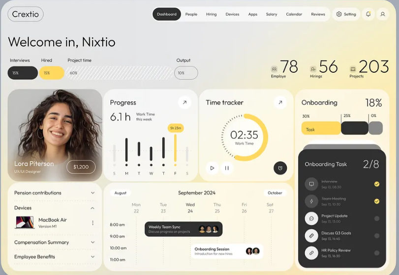

# 06 — UI Style Guide

**Reference design:** the "Crextio" HR dashboard supplied by the product owner. RealitySync adopts its visual language — soft frosted-glass cards on a warm gradient, a single yellow accent, charcoal pills, big light numerals — and re-maps its layout to data-consistency content.



*Reference: `docs/assets/reference-dashboard.png`. Agents MUST open this image before building any page.*

---

## 1. Design principles

1. **Calm surfaces, one loud color.** Everything is soft grey/white glass; yellow (`accent`) marks what matters now (selected day, active progress, primary highlight). Charcoal (`ink`) marks the primary action and the "live" card.
2. **Big light numbers.** Key metrics are huge, weight 300, with a tiny label beside them. Numbers are the hero, not chrome around them.
3. **Pills and rounded blocks.** Navigation, buttons, chips, inputs and progress bars are pill-shaped; content cards use large radii. No sharp corners anywhere.
4. **Bento layout.** Pages are built from a 12-column grid of differently-sized cards with consistent gaps; each card does one job.
5. **Dark card = live.** The one dark card on a page (Live feed on the dashboard) is the "happening now" surface; do not scatter dark cards.
6. **Evidence beside every claim.** Whenever AI text or a score is shown, the underlying evidence is visible next to it.
7. **Accessible by default.** Yellow is only ever a background for dark text. Meaning is never conveyed by color alone.

## 2. Color tokens

Define as CSS variables in `src/styles/tokens.css`; expose in Tailwind (`tailwind.config.ts`). **Never use raw hex values in components.**

### 2.1 Core palette
| Token | Hex | Usage |
|-------|-----|-------|
| `--ink-900` | `#1C1C1E` | Primary text, dark cards, primary buttons, active nav pill |
| `--ink-800` | `#2B2B2E` | Dark card inner rows, hover on dark |
| `--ink-600` | `#5C5C61` | Secondary text |
| `--ink-400` | `#9A9AA0` | Muted text, inactive bars, disabled |
| `--ink-200` | `#D9D9DD` | Dividers on light surfaces |
| `--paper-0` | `#FFFFFF` | Pure white |
| `--accent-300` | `#FBE38A` | Accent tint / hover tint |
| `--accent-400` | `#F8D347` | **Primary accent** (highlight bar, progress fill, chip) |
| `--accent-500` | `#F2C12E` | Accent pressed / strong |
| `--accent-100` | `#FFF6D6` | Accent wash backgrounds |

### 2.2 Background gradient (page)
```css
--bg-page: linear-gradient(135deg, #E9EAEC 0%, #F1EFE7 45%, #F8E9A6 100%);
```
Page background is fixed (`background-attachment: fixed`) so cards float over the gradient.

### 2.3 Surfaces
| Token | Value | Usage |
|-------|-------|-------|
| `--surface-glass` | `rgba(255,255,255,0.55)` | Standard card |
| `--surface-glass-strong` | `rgba(255,255,255,0.78)` | Drawer, modal, dropdown, tables |
| `--surface-border` | `rgba(255,255,255,0.65)` | 1px card border |
| `--surface-dark` | `#1C1C1E` | Live feed card |
| `--blur-glass` | `blur(24px) saturate(140%)` | `backdrop-filter` |

Fallback when `backdrop-filter` is unsupported: use `rgba(255,255,255,0.88)`.

### 2.4 Semantic colors
| Token | Hex | Tint bg (badge) | Usage |
|-------|-----|-----------------|-------|
| `--sev-critical` | `#D9453D` | `#FBE3E1` | Critical severity |
| `--sev-high` | `#E8832A` | `#FCE9D6` | High |
| `--sev-medium` | `#F2C12E` | `#FFF3CC` | Medium (same as accent) |
| `--sev-low` | `#8E9096` | `#ECECEE` | Low |
| `--success` | `#3FAE7A` | `#DDF3E8` | Resolved, consistent |
| `--info` | `#4A7BD0` | `#E3ECFA` | Info, links, AI badge |
| `--danger` | `#D9453D` | `#FBE3E1` | Errors/destructive |

Severity badges always show **icon + text** (`●` shape differs: critical = filled triangle, high = filled diamond, medium = filled circle, low = hollow circle) so color is not the only signal.

### 2.5 Contrast rules (must pass WCAG AA)
- `--ink-900` on `--accent-400`, `--paper-0`, glass: ✅
- `--paper-0` on `--ink-900`: ✅
- White text on yellow: ❌ never
- `--ink-400` is for non-essential text only (≥ 18px or decorative); use `--ink-600` for readable secondary text.

## 3. Typography

**Family:** `Inter` variable (self-hosted via `@fontsource-variable/inter`; no CDN). Fallback: `ui-sans-serif, system-ui, -apple-system, "Segoe UI", sans-serif`. Optional OpenType: `font-feature-settings: "cv11", "ss03"`.

| Token | Size / line-height | Weight | Tracking | Use |
|-------|-------------------|--------|----------|-----|
| `display-xl` | 64 / 64 | 300 | −0.03em | KPI big numbers (78, 56, 203 in reference) |
| `display-lg` | 48 / 52 | 300 | −0.025em | Card hero numbers (6.1 h, 18%) |
| `h1` | 40 / 44 | 300 | −0.02em | Page greeting ("Welcome back, Pranav") |
| `h2` | 28 / 34 | 400 | −0.01em | Section headings |
| `h3` | 20 / 28 | 500 | 0 | Card titles ("Live feed", "Progress") |
| `body` | 15 / 24 | 400 | 0 | Default |
| `body-strong` | 15 / 24 | 500 | 0 | Emphasis |
| `small` | 13 / 20 | 400 | 0 | Secondary info, table cells |
| `caption` | 12 / 16 | 400 | 0.01em | Hints, timestamps |

Rules
- **Sentence case everywhere.** No ALL CAPS labels, no letter-spaced eyebrows.
- Numerals in tables/timelines use `tabular-nums`; display numerals do not.
- Line length ≤ 70 characters for paragraphs (AI explanations).
- Light weight (300) only at ≥ 36px; below that use 400+.

## 4. Spacing, radius, elevation, grid

**Spacing scale (4px base):** `4, 8, 12, 16, 20, 24, 32, 40, 48, 64`.
| Context | Value |
|---------|-------|
| Card inner padding | 20 (compact) / 24 (default) |
| Gap between cards | 16 |
| Page horizontal padding | 16 (mobile) / 24 (tablet) / 32 (desktop) |
| Section vertical gap | 24 |
| Max content width | 1440 |

**Radius**
| Token | px | Use |
|-------|----|-----|
| `r-card` | 28 | Cards |
| `r-inner` | 20 | Cards inside cards, rows on dark card |
| `r-control` | 999 | Buttons, inputs, chips, nav, progress bars |
| `r-drawer` | 28 | Drawer/ modal corners |

**Elevation**
| Token | Value |
|-------|-------|
| `shadow-glass` | `0 8px 32px rgba(28,28,30,0.06), inset 0 1px 0 rgba(255,255,255,0.7)` |
| `shadow-dark` | `0 16px 40px rgba(28,28,30,0.22)` |
| `shadow-pop` | `0 12px 40px rgba(28,28,30,0.16)` (dropdowns, toasts) |

**Grid:** 12 columns, 16px gutter, bento rows `auto`. Cards declare `col-span` per breakpoint.

**Breakpoints:** `sm 640 · md 768 · lg 1024 · xl 1280 · 2xl 1536`.

## 5. App shell and navigation

Top bar (sticky, transparent over gradient), left → right, matching the reference:
1. **Logo pill** — outlined pill (1px `--ink-900`, radius 999) with the wordmark "RealitySync".
2. **Primary nav pill group** — one white-glass pill containing text items; the **active item is a filled `--ink-900` pill with white text**. Items: Dashboard · Entities · Findings · Review · Alerts · Rules · Systems · Simulation. Review (with a small count chip for links needing review) is analyst+; Rules, Systems and Simulation are admin-only. Items a role cannot use are hidden. Routes are listed in 02 §3.1.
3. **Right actions** — "Settings" outlined pill with gear icon, circular bell button (unread dot in `--accent-400`, count badge), circular user avatar button (menu: profile, users (admin), sign out).

Mobile (< 768): logo pill + hamburger + bell; nav becomes a full-height glass sheet.

Connection status: a tiny dot in the bell area — green when WebSocket connected, grey with tooltip "Reconnecting…" otherwise.

## 6. Components

All primitives live in `src/components/ui/` and are the **only** place raw styles for these elements are defined.

| Component | Spec (from reference) |
|-----------|----------------------|
| `GlassCard` | `--surface-glass`, blur, 1px border, `r-card`, `shadow-glass`, padding 24. Header row: `h3` title left, optional circular arrow/“open” icon button right (36px, white). |
| `DarkCard` | `--surface-dark`, white text, `r-card`, `shadow-dark`. Inner rows use `--ink-800` + `r-inner`. |
| `PillNav` / `NavItem` | Container white-glass pill, height 44, padding 4. Item: padding 0 16, `body-strong`; active = ink-900 fill, white text. |
| `Button` | Height 44, pill. **primary**: ink-900 fill, white text. **accent**: accent-400 fill, ink-900 text. **secondary**: transparent, 1px ink-900 border. **ghost**: no border, hover glass. **danger**: danger fill, white. Disabled: 40% opacity. |
| `IconButton` | 44px circle, white-glass; sm = 36px. Always `aria-label`. |
| `StatNumber` | Big number (`display-xl`) + small icon-label to its left/below ("Employee" with icon in reference → "Entities"). |
| `PillMeter` | Labeled horizontal pill (height 40) filled with accent/dark/hatched grey; value shown inside ("15%"). Used in the KPI strip. Hatched pattern = unknown/pending. |
| `ColumnBars` | Vertical rounded bars (ink-900) with a dot on the baseline; highlighted bar in accent-400 with a small floating tooltip chip above (like "5h 23m"). Weekday letters under bars. |
| `RingGauge` | Thick circular arc in accent-400 on a faint track, tick marks around, big center value in `display-lg`; play/pause style round controls underneath (here: pause live updates, refresh). |
| `AccordionRow` | Collapsible list rows with chevrons inside a glass card (reference "Pension contributions / Devices"). |
| `TimelineGrid` | Day columns with hour rows; events as pills (dark = primary, white = secondary) with tiny avatar stack. Used for the Entity timeline. |
| `LiveFeedItem` | On DarkCard: circular icon (40) + title + small time + trailing status circle (accent check when handled). Resolved items show strike-through title (as in reference "Team meeting"). |
| `SeverityBadge` | Pill, tint bg + dark text + shape icon + label ("High"). |
| `ConfidenceMeter` | Small ring (24–48px) + percentage; color ramp: < 0.6 grey, 0.6–0.85 accent, ≥ 0.85 ink-900. Tooltip shows breakdown (link / rule / evidence / recency). |
| `SystemChip` | Pill with system dot + name (CRM, Billing, Support). Each system has a fixed icon; colors stay neutral (do not introduce new hues). |
| `DiffRow` | Three-column row: field name · CRM value · Billing value · Support value; differing cells get accent-100 fill + accent-400 left border; matching cells plain. |
| `Avatar` | Circle with initials on soft gradient (accent-300 → paper). Entities have no photos. |
| `Input` / `Select` / `Search` | Height 44, pill, white-glass, 1px `--ink-200` border, focus ring. Search has leading magnifier icon. |
| `Tabs` | Pill segmented control, active = ink-900 fill. |
| `Table` | Glass-strong card; row height 56; no zebra; hover = accent-100 wash; sticky header; sortable headers with chevron. |
| `Drawer` | Right side, 560px (full-screen on mobile), glass-strong, `r-drawer` on left corners. |
| `Toast` | Glass-strong pill-card, bottom-right; severity icon; critical toasts persist. |
| `Skeleton` | Glass block with 1.4 s shimmer (disabled under reduced motion). |
| `EmptyState` | Soft icon circle + one sentence + one action button. |
| `ErrorState` | Like `EmptyState`, with a danger-tint icon circle, the error sentence (§9 copy rules) and a "Retry" secondary button. |
| `Switch` | Radix Switch; pill track 44×24, off = `--ink-200`, on = `--ink-900`, white thumb; label always visible. |
| `Slider` | Radix Slider; pill track (height 8) in `--ink-200`, fill `--accent-400`, 24px `--ink-900` thumb; value shown next to it with `tabular-nums`. |
| `Dialog` | Radix Dialog; centered, max-width 480, glass-strong, `r-card`, `shadow-pop`; used for confirmations (reset) and one-time secrets (API key). Esc closes. |

### Interaction states
- Hover: surfaces +4% white; buttons darken one step. Pressed: scale 0.98.
- Focus-visible: `outline: 2px solid var(--ink-900); outline-offset: 2px` (on dark surfaces: `--accent-400`).
- Selected row/card: accent-400 left border 3px (cards) or accent-100 fill (rows).

## 7. Page layouts

### 7.1 Dashboard (maps the reference 1:1)

Reference element → RealitySync element:

| Reference | RealitySync |
|-----------|-------------|
| "Welcome in, Nixtio" | "Welcome back, {first name}" + one-line status ("3 new findings since you left") |
| KPI pills (Interviews 15%, Hired 15%, Project time 60%, Output 10%) | **PillMeters:** Consistency score, High & critical share, Explained by AI, Links needing review |
| Big numbers 78 / 56 / 203 | **Entities**, **Systems** (3), **Open findings** |
| Portrait card (Lora Piterson, salary chip) | **Spotlight entity** — highest-priority inconsistent entity: gradient avatar, name, role chip "3 systems", priority chip |
| "Progress" bars by weekday | **Findings this week** — bars per day (created), today in accent with tooltip "12 new" |
| "Time tracker" ring | **Ingest ring** — live events/sec with pause-live toggle; ring arc = pending queue depth |
| "Onboarding" 18% + segmented pills | **Resolution progress** — resolved vs open vs false-positive segmented pills |
| Accordion (Pension, Devices, Compensation…) | **System health accordion** — CRM, Billing, Support rows expand to per-system issue counts |
| Calendar (Weekly Team Sync…) | **Recent activity timeline** — latest conflicting events across systems |
| Dark "Onboarding Task 2/8" | **Live feed** (DarkCard) — streaming alerts, "handled 2/8" counter |

```
┌────────────────────────────────────────────────────────────────────────────────┐
│ (RealitySync)  [ Dashboard | Entities | Findings | Alerts | Rules | … ]  ⚙ 🔔 👤│
│ Welcome back, Pranav                                  ▣ 500   ▣ 3    ▣ 62       │
│ [Consistency 91%][High+crit 27%][Explained 96%][Review 9]  Entities Systems Open│
│ ┌ Spotlight ─┐ ┌ Findings this week ┐ ┌ Ingest ring ─┐ ┌ Resolution 41% ─────┐ │
│ │  avatar    │ │ ▮ ▮ ▮ ▮ ▮ ▮ ▮      │ │   ◔ 12/s     │ │ ▭▭▭▭ ▭▭ ▭           │ │
│ └────────────┘ └────────────────────┘ └──────────────┘ │ ┏ Live feed 2/8 ━━┓ │ │
│ ┌ System health ▾ ┐ ┌ Recent activity timeline ────────┐ │ ┃ ● R004 …      ✓ ┃ │ │
│ │ CRM / Billing … │ │  Mon Tue Wed Thu Fri             │ │ ┃ ● R008 …      ○ ┃ │ │
│ └─────────────────┘ └──────────────────────────────────┘ └─┗━━━━━━━━━━━━━━━━━┛─┘ │
└────────────────────────────────────────────────────────────────────────────────┘
```

### 7.2 Findings
Toolbar: search pill, filter pills (status, severity, system, rule, min confidence), sort select, bulk-action button, "Export CSV" secondary button (analyst+; uses the current filters). Table columns: severity badge · title · entity · systems chips · confidence meter · status · detected (relative) · SLA flag. Row click → **Drawer** (finding detail):
1. Header: title, severity badge, status pill, confidence meter.
2. **Evidence** panel (`DiffRow`s + timestamps).
3. **AI explanation** card (summary, likely cause, suggested actions) with badge "AI-generated" (info tint) or "Template" and a "Regenerate" ghost button.
4. History timeline.
5. Action bar (sticky bottom): Acknowledge (secondary) · Resolve (primary) · Mark as false positive (ghost, requires note).

### 7.3 Entity detail
Left: glass card with avatar, canonical name/email, health chip, open-findings count. Center: three **system columns** (CRM / Billing / Support) as stacked glass cards listing normalized fields, differing values highlighted; children (subscriptions, invoices, tickets) under each system. Right: findings list + `TimelineGrid`. Link cards show match confidence with expandable feature breakdown.

### 7.4 Link review
Queue list on the left (score descending); right side shows two records side by side with matching/different fields; buttons: "Same customer" (primary) / "Not the same" (secondary). Keyboard: `Y` confirm, `N` reject, `J/K` navigate.

### 7.5 Alerts
Full-page list grouped by day; unread have accent dot; filters by type/severity; "Mark all as read".

### 7.6 Rules / Systems / Simulation / Evaluation / Users (admin)
- Rules: table with enable switch, severity select, config drawer (form generated from rule config schema).
- Systems: card per system with reliability slider (pill track) and field-authority editor; below the cards, a "Failed events" table (from `GET /ingest/events?status=failed`) with a "Retry" button per row.
- Simulation: form card (seed, customers, anomaly rate, speed, anomaly types) + run status ring + **Simulate drift** accent button.
- Evaluation: big numerals for precision/recall/F1 (`display-xl`), matching precision/recall as smaller `display-lg` numbers, per-type bars, misses/false-positive list.

### 7.7 Settings
`Tabs`: **Profile** (name, email, role, change password form) · **Users** (admin: table + create/deactivate) · **API keys** (admin: list, create — secret shown once in a copyable field with a warning, revoke) · **Audit log** (admin: filterable table). Reached from the Settings pill and the avatar menu.

## 8. Motion
- Duration 160–240 ms, easing `cubic-bezier(0.2, 0.8, 0.2, 1)`.
- **One orchestrated moment:** on first dashboard load, KPI numbers count up (600 ms) and cards fade in with 40 ms stagger. Nothing else animates on load.
- Motion that answers an action: drawer slide (240 ms), accordion expand, toast enter.
- Live data: new feed item slides in from top (240 ms) with a yellow background flash (1.2 s fade). If the user has scrolled, do not move content; show a "N new" pill instead.
- `prefers-reduced-motion: reduce` → disable all non-essential motion (counts show final value).

## 9. Writing style (microcopy)
- Sentence case, plain verbs, active voice. Buttons name the result: "Resolve finding", "Confirm match", "Start simulation".
- Keep action names consistent: button "Resolve" → toast "Finding resolved".
- Errors say what happened and how to fix it; no apologies: "Couldn't load findings. Check your connection and retry."
- Empty states invite action: "No findings yet. Start a simulation to generate data."
- Use user language: "Customer", "mismatch", "match confidence" — not "entity resolution" or "idempotency".
- AI text is always labeled and never the only explanation; evidence is adjacent.

## 10. Accessibility checklist (per component/page)
- [ ] Keyboard reachable in logical order; no keyboard traps; Esc closes drawers/modals.
- [ ] Visible focus on every interactive element.
- [ ] `aria-label` on icon buttons; `aria-live="polite"` region for the live feed (critical = `assertive`).
- [ ] Tables use semantic `<table>` with scope headers.
- [ ] Color contrast verified; severity has shape + text.
- [ ] Touch targets ≥ 44 px.
- [ ] Reduced motion respected.

## 11. Implementation snippets

`src/styles/tokens.css`
```css
:root {
  --ink-900:#1C1C1E; --ink-800:#2B2B2E; --ink-600:#5C5C61; --ink-400:#9A9AA0; --ink-200:#D9D9DD;
  --paper-0:#FFFFFF;
  --accent-100:#FFF6D6; --accent-300:#FBE38A; --accent-400:#F8D347; --accent-500:#F2C12E;
  --sev-critical:#D9453D; --sev-high:#E8832A; --sev-medium:#F2C12E; --sev-low:#8E9096;
  --success:#3FAE7A; --info:#4A7BD0; --danger:#D9453D;
  --bg-page:linear-gradient(135deg,#E9EAEC 0%,#F1EFE7 45%,#F8E9A6 100%);
  --surface-glass:rgba(255,255,255,.55); --surface-glass-strong:rgba(255,255,255,.78);
  --surface-border:rgba(255,255,255,.65);
  --r-card:28px; --r-inner:20px;
  --shadow-glass:0 8px 32px rgba(28,28,30,.06), inset 0 1px 0 rgba(255,255,255,.7);
  --shadow-dark:0 16px 40px rgba(28,28,30,.22);
  --shadow-pop:0 12px 40px rgba(28,28,30,.16);
  --sev-critical-tint:#FBE3E1; --sev-high-tint:#FCE9D6; --sev-medium-tint:#FFF3CC; --sev-low-tint:#ECECEE;
  --success-tint:#DDF3E8; --info-tint:#E3ECFA;
}
body { background: var(--bg-page); background-attachment: fixed; color: var(--ink-900);
       font-family: "Inter Variable", ui-sans-serif, system-ui, sans-serif; }
.glass { background: var(--surface-glass); border: 1px solid var(--surface-border);
         border-radius: var(--r-card); box-shadow: var(--shadow-glass);
         -webkit-backdrop-filter: blur(24px) saturate(140%); backdrop-filter: blur(24px) saturate(140%); }
@supports not (backdrop-filter: blur(1px)) { .glass { background: rgba(255,255,255,.88); } }
```

`tailwind.config.ts` (excerpt)
```ts
export default {
  theme: {
    extend: {
      colors: {
        ink: { 900:'var(--ink-900)', 800:'var(--ink-800)', 600:'var(--ink-600)', 400:'var(--ink-400)', 200:'var(--ink-200)' },
        accent: { 100:'var(--accent-100)', 300:'var(--accent-300)', 400:'var(--accent-400)', 500:'var(--accent-500)' },
        sev: { critical:'var(--sev-critical)', high:'var(--sev-high)', medium:'var(--sev-medium)', low:'var(--sev-low)' },
        paper: { 0:'var(--paper-0)' },
        success:'var(--success)', info:'var(--info)', danger:'var(--danger)',
        surface: { glass:'var(--surface-glass)', strong:'var(--surface-glass-strong)', border:'var(--surface-border)', dark:'var(--ink-900)' },
      },
      borderRadius: { card:'var(--r-card)', inner:'var(--r-inner)', drawer:'var(--r-card)' },
      boxShadow: { glass:'var(--shadow-glass)', dark:'var(--shadow-dark)', pop:'var(--shadow-pop)' },
      fontSize: {
        'display-xl':['64px',{lineHeight:'64px',letterSpacing:'-0.03em',fontWeight:'300'}],
        'display-lg':['48px',{lineHeight:'52px',letterSpacing:'-0.025em',fontWeight:'300'}],
        h1:['40px',{lineHeight:'44px',letterSpacing:'-0.02em',fontWeight:'300'}],
      },
    },
  },
};
```

## 12. Design rules for agents (do / don't)
**Do**
- Compose pages from `components/ui` primitives and tokens only.
- Keep one accent (yellow) and one dark surface per page.
- Show loading, empty, and error states for every data view.
- Use `lucide-react` line icons, 20px default, stroke 1.75.

**Don't**
- Don't introduce new colors, gradients, shadows, or radii outside this guide.
- Don't use ALL CAPS, letter-spaced labels, or decorative numbering.
- Don't use stock photos; use initials avatars.
- Don't put white text on yellow, or yellow text on light surfaces.
- Don't add a dark mode in the MVP (dark cards are a component, not a theme).
- Don't animate on load beyond the single dashboard sequence.
